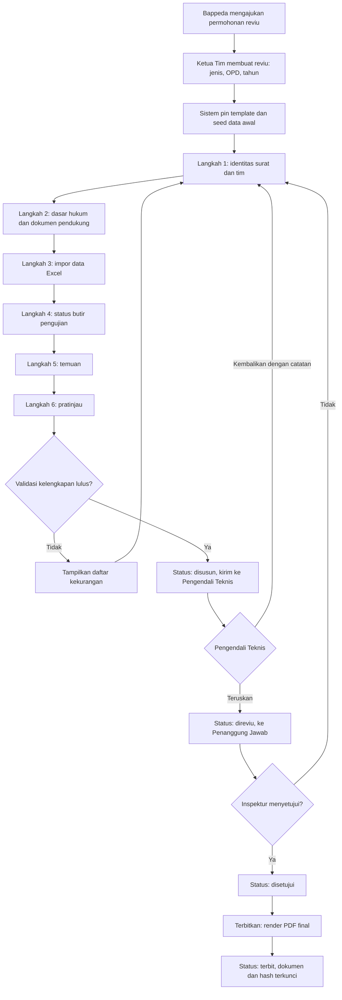
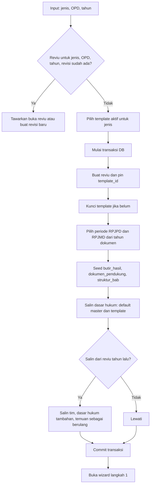
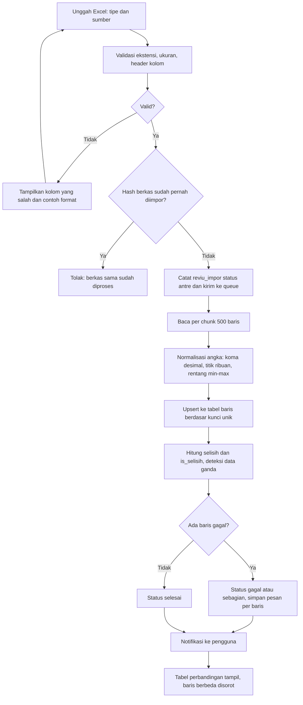
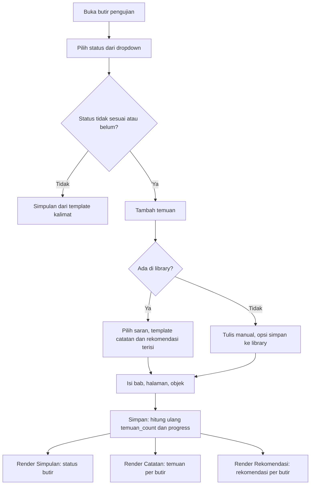
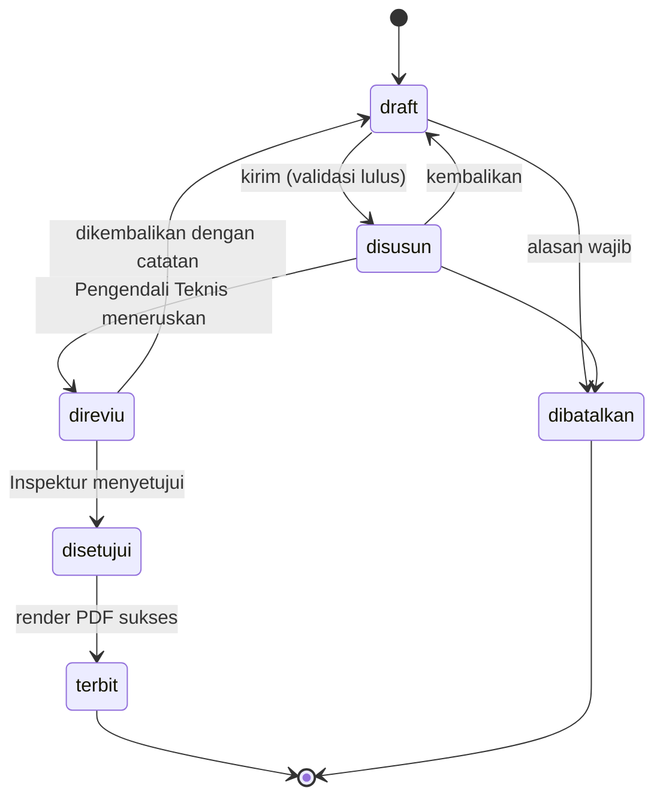
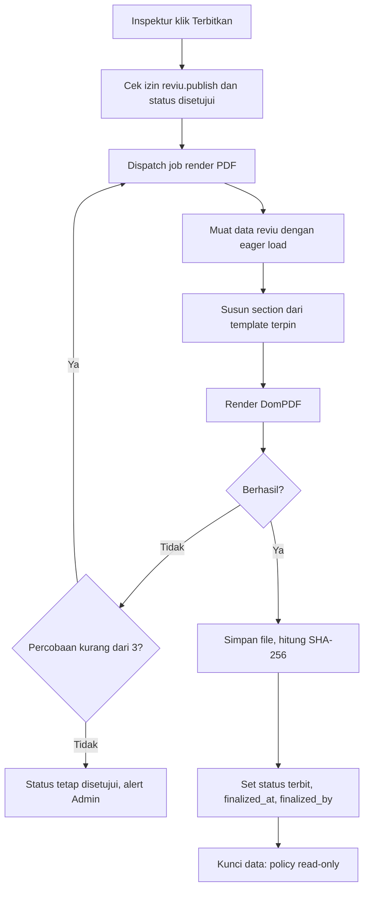
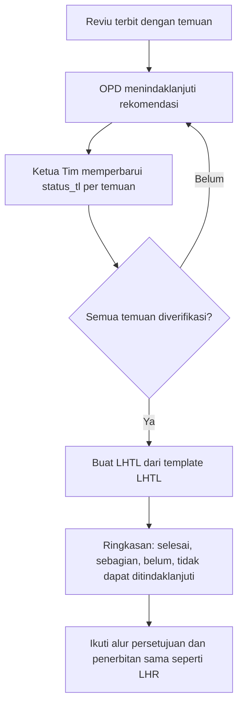

# PRD: Fitur Laporan Hasil Reviu (LHR) pada SIMANTAB

|                 |                                                                                                             |
| --------------- | ----------------------------------------------------------------------------------------------------------- |
| Produk          | SIMANTAB – Inspektorat Daerah Kabupaten Rembang                                                             |
| Fitur           | Penyusunan LHR reviu dokumen perencanaan (RKPD dahulu; Renstra, SHSD, KUA-PPAS, LHTL menyusul)              |
| Status          | Draf 1.0 – 24 September 2026                                                                                |
| Stack           | Laravel 12, Blade, TailAdmin, Tailwind, Alpine.js, Spatie Permission dan ActivityLog, DomPDF, Laravel-Excel |
| Dokumen terkait | `SKEMA-LHR-REVIU.md` dan dua migration                                                                      |

## 1. Latar belakang

Laporan reviu RKPD disusun manual dalam Word. Analisis tiga laporan (RKPD 2025, 2026, 2027) menunjukkan sekitar 70% isinya baku atau turunan data lain. Hanya identitas penugasan, status hasil uji, dan catatan temuan yang benar-benar baru tiap tahun. Masalah saat ini:

- Bagian baku diketik ulang tiap laporan (kop, tujuan, metodologi, dasar hukum, dokumen pendukung, apresiasi).
- Temuan yang sama ditulis tiga kali (Simpulan, Catatan, Rekomendasi).
- Tabel perbandingan fiskal dan indikator dibuat manual, rawan salah salin. Contoh selisih yang ditemukan reviu: IPM 74,38 vs 73,70 dan pertumbuhan ekonomi 5,90–7,75 vs 5,40–6,20 (RKPD 2027).
- Butir pengujian berubah antar era regulasi (3 butir di 2025, 9 di 2026, 8 butir plus format di 2027), tetapi tidak ada versi template.
- Temuan berulang antar tahun tidak terlacak.

## 2. Tujuan dan metrik

| Tujuan                  | Metrik                                      | Target                                    |
| ----------------------- | ------------------------------------------- | ----------------------------------------- |
| Kurangi beban input     | Field yang diketik user per laporan         | turun ≥ 60% vs Word                       |
| Percepat penyusunan     | Waktu dari data lengkap sampai draf PDF     | ≤ 1 hari kerja (baseline diukur di pilot) |
| Kurangi kesalahan angka | Selisih fiskal/indikator dideteksi otomatis | 100% baris ter-diff                       |
| Konsistensi format      | Laporan sesuai template versi aktif         | 100%                                      |
| Keterlacakan            | Temuan berulang tertaut ke tahun sebelumnya | ≥ 90%                                     |
| Kinerja                 | Render pratinjau (p95)                      | ≤ 2 detik; daftar ≤ 500 ms                |

## 3. Ruang lingkup

**Masuk (MVP):** template berversi, wizard 6 langkah, impor Excel (fiskal, indikator, program), diff otomatis, library temuan, pratinjau, alur persetujuan, PDF final, audit trail, hak akses.

**Fase berikut:** jenis Renstra, SHSD, KUA-PPAS; LHTL; salin dari reviu tahun lalu; tanda tangan elektronik.

**Di luar lingkup:** membuat atau mengedit dokumen RKPD itu sendiri, integrasi langsung API SIPD-RI (memakai file export dahulu), analisis substansi otomatis oleh sistem (penilaian tetap oleh tim reviu).

## 4. Pengguna dan peran

| Peran                        | Kegiatan utama                                    | Akses                          |
| ---------------------------- | ------------------------------------------------- | ------------------------------ |
| Admin Reviu                  | Kelola master, template, regulasi, library temuan | penuh pada master              |
| Ketua Tim                    | Membuat reviu, mengelola tim, menyusun laporan    | buat/ubah reviu timnya         |
| Anggota Tim                  | Mengisi status butir, temuan, impor data          | ubah pada reviu timnya         |
| Pengendali Teknis            | Mereviu draf, memberi catatan, meneruskan         | baca, ubah status ke `direviu` |
| Penanggung Jawab (Inspektur) | Menyetujui dan menerbitkan                        | approve, publish               |
| Pembaca OPD (opsional)       | Melihat laporan terbit milik OPD-nya              | baca laporan `terbit`          |

## 5. User stories utama

1. Sebagai Ketua Tim, saya memilih jenis, OPD, dan tahun sehingga template, dasar hukum, dan periode RPJMD terisi otomatis.
2. Sebagai Anggota Tim, saya mengunggah Excel Rankir RKPD, RPJMD, dan SIPD-RI lalu melihat selisih tanpa mengetik.
3. Sebagai Anggota Tim, saya memilih temuan dari library, mengisi halaman, dan hasilnya muncul di Simpulan, Catatan, dan Rekomendasi.
4. Sebagai Pengendali Teknis, saya melihat pratinjau dan mengembalikan draf dengan catatan.
5. Sebagai Inspektur, saya menyetujui dan menerbitkan; PDF final terkunci dan punya hash.
6. Sebagai Admin, saya membuat versi template baru saat regulasi berganti tanpa mengubah laporan lama.

## 6. Kebutuhan fungsional

Prioritas: **M** wajib (MVP), **S** sebaiknya, **C** opsional.

| ID    | Kebutuhan                                                                                               | P          |
| ----- | ------------------------------------------------------------------------------------------------------- | ---------- |
| FR-01 | Master jenis reviu, template versi, section, butir, dokumen pendukung, struktur bab standar             | M          |
| FR-02 | Template terkunci setelah dipakai; perubahan = clone versi baru                                         | M          |
| FR-03 | Buat reviu: pin template, seed butir, dokumen, struktur bab, dasar hukum, periode RPJPD/RPJMD           | M          |
| FR-04 | Unik per (jenis, OPD, tahun, revisi); dukung reviu ulang (`revisi_ke`)                                  | M          |
| FR-05 | Penomoran surat otomatis dari pola template (`700/{urut:3}/REVIU/INSP/{tahun}`), dapat diubah manual    | M          |
| FR-06 | Form identitas: penerima, lampiran, permohonan, ST, tanggal mulai/selesai                               | M          |
| FR-07 | Tim reviu dari master pegawai, disimpan sebagai snapshot nama/NIP/jabatan                               | M          |
| FR-08 | Penandatangan disimpan sebagai snapshot (pangkat berbeda antar tahun)                                   | M          |
| FR-09 | Dasar hukum: default dari master (`is_dasar_tetap`) + tambah dari master regulasi                       | M          |
| FR-10 | Checklist dokumen pendukung (ada/belum/NA)                                                              | M          |
| FR-11 | Perbandingan format bab vs standar; `is_sesuai` dihitung otomatis                                       | M          |
| FR-12 | Status per butir via dropdown; kalimat simpulan dari `simpulan_template`, dapat di-override             | M          |
| FR-13 | Temuan: pilih library, isi bab/halaman, ubah catatan/rekomendasi, urutkan drag-drop                     | M          |
| FR-14 | Satu temuan dirender di Simpulan, Catatan, dan Rekomendasi                                              | M          |
| FR-15 | Impor Excel fiskal, indikator, program via queue; validasi header, parse angka desimal koma dan rentang | M          |
| FR-16 | Diff otomatis fiskal (Rankir vs RPJMD vs SIPD) dan indikator (RKPD vs RPJMD); sorot baris berbeda       | M          |
| FR-17 | Deteksi data ganda program dari `dup_hash`                                                              | S          |
| FR-18 | Pratinjau HTML dengan cache berdasar `updated_at`                                                       | M          |
| FR-19 | Alur status: draft, disusun, direviu, disetujui, terbit, dibatalkan                                     | M          |
| FR-20 | Validasi kelengkapan sebelum kirim: butir wajib terisi, tim lengkap, nomor surat ada                    | M          |
| FR-21 | PDF final via queue, simpan path dan SHA-256; setelah terbit read-only                                  | M          |
| FR-22 | Audit trail (ActivityLog) untuk reviu, butir, temuan, perubahan status                                  | M          |
| FR-23 | Daftar reviu: filter tahun/OPD/status, progress dan jumlah temuan tanpa agregat                         | M          |
| FR-24 | Salin dari reviu tahun lalu (tim, dasar hukum, temuan ditandai berulang)                                | S          |
| FR-25 | Tautan temuan ke temuan tahun lalu (`temuan_sebelumnya_id`)                                             | S          |
| FR-26 | Export Excel rekap temuan                                                                               | C          |
| FR-27 | LHTL: status tindak lanjut per temuan, verifikasi, cetak LHTL                                           | S (fase 2) |
| FR-28 | Autosave per langkah wizard; peringatan konflik edit (optimistic)                                       | S          |

## 7. Aturan bisnis

- BR-1: Satu reviu memakai satu versi template dan tidak berubah setelah dibuat.
- BR-2: Reviu berstatus `terbit` tidak dapat diubah; koreksi = reviu ulang (`revisi_ke` + 1).
- BR-3: Reviu final tidak dihapus, hanya `dibatalkan` dengan alasan.
- BR-4: Dasar hukum menyesuaikan pedoman reviu pada template (Permendagri 10/2018 atau 3/2026).
- BR-5: Butir berstatus tidak sesuai/belum wajib punya minimal satu temuan (peringatan, bukan blokir).
- BR-6: Selisih = nilai Rankir dikurangi nilai pembanding; baris dengan salah satu nilai kosong ditandai "tidak lengkap".
- BR-7: Nomor surat unik; urutan dapat disarankan tetapi tidak dipaksa.
- BR-8: Hanya pengguna dengan izin `reviu.publish` yang boleh menerbitkan.

## 8. Alur dan flowchart

### 8.1 Alur end-to-end

### 8.2 Membuat reviu dan seed data

### 8.3 Impor data dan diff otomatis

### 8.4 Temuan: input sekali, tiga tampilan

### 8.5 Status reviu

### 8.6 Finalisasi dan PDF

### 8.7 LHTL (fase 2)

## 9. Kebutuhan UX

**Wizard 6 langkah** dengan progress bar dan autosave:

| Langkah     | Isi                                              | Kemudahan                                                   |
| ----------- | ------------------------------------------------ | ----------------------------------------------------------- |
| 1 Identitas | surat, penerima, ST, tanggal, tim, penandatangan | nomor disarankan otomatis, tim dipilih dari master          |
| 2 Acuan     | dasar hukum, dokumen pendukung                   | centang cepat, default terisi                               |
| 3 Data      | impor Excel, tabel diff                          | seret dan lepas berkas, contoh template Excel dapat diunduh |
| 4 Butir     | status per butir                                 | dropdown, kalimat simpulan otomatis                         |
| 5 Temuan    | daftar temuan                                    | pilih dari library, drag-drop urutan                        |
| 6 Pratinjau | render laporan, checklist kelengkapan            | tautan langsung ke bagian yang kurang                       |

Prinsip: default cerdas, tidak ada field yang bisa diturunkan tetapi diminta, pesan galat spesifik, mobile-friendly untuk peninjauan, indikator "terakhir disimpan".

**Layar:** Daftar reviu, Wizard, Pratinjau, Master (template, regulasi, library temuan), Riwayat aktivitas, Pengaturan hak akses.

## 10. Kebutuhan non-fungsional

- **Kinerja:** render pratinjau p95 ≤ 2 s untuk laporan ±200 temuan; impor 5.000 baris ≤ 60 s di queue; halaman daftar tanpa N+1.
- **Keamanan:** Spatie Permission per aksi, policy per reviu (hanya tim dan peran terkait), validasi berkas (mime, ukuran maksimum 10 MB), penyimpanan berkas di disk privat, ULID di URL, Turnstile pada login, CSRF, sanitasi HTML narasi.
- **Integritas:** transaksi pada pembuatan reviu, unique key bisnis, hash PDF, template terkunci.
- **Audit:** semua perubahan status dan data inti dicatat dengan pengguna dan waktu.
- **Ketersediaan dan pemulihan:** backup harian DB dan disk dokumen; job queue dengan retry dan alert.
- **Kompatibilitas:** MySQL 8 atau MariaDB 10.6+; peramban modern.

## 11. Data dan integrasi

Skema terperinci di `SKEMA-LHR-REVIU.md`. Integrasi: tabel OPD dan pengguna SIMANTAB, Spatie Permission, ActivityLog, DomPDF, Laravel-Excel. Sumber data eksternal berupa berkas export (Rankir RKPD, RPJMD Tabel 3.6, SIPD-RI). Format Excel harus disepakati (lihat pertanyaan terbuka).

## 12. Kriteria penerimaan (contoh)

- **Buat reviu:** diberikan template aktif, ketika Ketua Tim membuat reviu RKPD 2027 untuk Bappeda, maka butir, dokumen, struktur bab, dasar hukum, dan periode RPJMD 2025–2029 terisi tanpa input tambahan.
- **Diff indikator:** diberikan Excel Rankir dan RPJMD, ketika target IPM 74,38 vs 73,70, maka baris ditandai selisih dan tampil di lampiran.
- **Satu temuan tiga tampilan:** diberikan satu temuan pada butir 4, maka catatannya tampil pada Catatan dan rekomendasinya pada Rekomendasi tanpa input kedua.
- **Kunci final:** diberikan reviu berstatus terbit, ketika pengguna mencoba mengubah temuan, maka ditolak dan tercatat.
- **Snapshot:** diberikan pangkat Inspektur berubah di master, maka laporan lama tetap menampilkan pangkat saat terbit.
- **Berkas ganda:** mengunggah file yang sama dua kali ditolak.

## 13. Rilis

| Fase    | Isi                                                                     | Estimasi   |
| ------- | ----------------------------------------------------------------------- | ---------- |
| 0       | Konfirmasi format Excel, seed master dan template RKPD (2026, 2027)     | 1 minggu   |
| 1 (MVP) | FR bertanda M: wizard, impor, diff, temuan, pratinjau, persetujuan, PDF | 6–8 minggu |
| 2       | Salin tahun lalu, temuan berulang, LHTL, jenis Renstra/SHSD/KUA-PPAS    | 4–6 minggu |
| 3       | Tanda tangan elektronik, dashboard tren temuan, export Excel            | menyusul   |

Estimasi kasar; sesuaikan setelah pilot.

## 14. Risiko dan mitigasi

| Risiko                               | Dampak                         | Mitigasi                                                                     |
| ------------------------------------ | ------------------------------ | ---------------------------------------------------------------------------- |
| Format Excel SIPD-RI berubah         | Impor gagal                    | mapping kolom di konfigurasi, contoh template, pesan galat jelas             |
| Regulasi baru mengubah butir         | Template usang                 | template berversi, admin clone versi baru                                    |
| User ingin mengubah kalimat baku     | Kaku                           | override narasi per butir, section teks statis dapat diedit admin            |
| Data lama (Word) belum ada di sistem | Temuan berulang tidak terlacak | impor manual laporan 2025–2027 sebagai baseline                              |
| Beban render PDF                     | Antrean lambat                 | queue terpisah, cache pratinjau, retry                                       |
| Salah setuju atau salah terbit       | Dokumen keliru                 | validasi kelengkapan, status `disetujui` terpisah dari `terbit`, reviu ulang |

<?php

use Illuminate\Database\Migrations\Migration;
use Illuminate\Database\Schema\Blueprint;
use Illuminate\Support\Facades\Schema;

/**
 * LAYER 1 - MASTER / TEMPLATE (jarang berubah, di-cache, dikunci setelah dipakai)
 *
 * Asumsi: MySQL 8 / MariaDB 10.6+, utf8mb4. Status memakai string + PHP backed enum
 * (bukan DB enum) supaya migrasi nilai baru tidak perlu ALTER TABLE.
 */
return new class extends Migration
{
    public function up(): void
    {
        // Jenis dokumen yang direviu: RKPD, RENSTRA, SHSD, KUA_PPAS, ...
        Schema::create('reviu_jenis', function (Blueprint $t) {
            $t->id();
            $t->string('kode', 20)->unique();
            $t->string('nama', 120);
            $t->boolean('is_aktif')->default(true);
            $t->timestamps();
        });

        // Versi template per jenis. Contoh: RKPD-PERMENDAGRI-10-2018, RKPD-PERMENDAGRI-3-2026.
        // Setelah dipakai reviu, terkunci (terkunci_at terisi) -> perubahan = clone versi baru.
        Schema::create('reviu_template', function (Blueprint $t) {
            $t->id();
            $t->foreignId('jenis_id')->constrained('reviu_jenis')->restrictOnDelete();
            $t->string('kode', 60)->unique();
            $t->string('nama', 150);
            $t->string('pedoman_reviu', 200)->nullable();   // "Permendagri 3/2026 ttg Reviu ..."
            $t->string('pola_nomor', 120)->nullable();      // "700/{urut:3}/REVIU/INSP/{tahun}"
            $t->date('berlaku_mulai')->nullable();
            $t->date('berlaku_sampai')->nullable();
            $t->boolean('is_aktif')->default(true);
            $t->timestamp('terkunci_at')->nullable();
            $t->timestamps();

            $t->index(['jenis_id', 'is_aktif']);
        });

        // Kerangka bab laporan (urutan, tipe render, isi baku dengan placeholder {tahun}, {opd}, ...)
        Schema::create('reviu_template_section', function (Blueprint $t) {
            $t->id();
            $t->foreignId('template_id')->constrained('reviu_template')->cascadeOnDelete();
            $t->string('kode', 30);
            $t->string('judul', 200);
            $t->unsignedSmallInteger('urutan');
            // teks_statis | dasar_hukum | tim | dokumen_pendukung | format_bab | hasil_butir
            // | fiskal | indikator | program_ganda | temuan | ttd
            $t->string('tipe', 30);
            $t->text('isi_template')->nullable();
            $t->boolean('is_wajib')->default(true);
            $t->boolean('is_lampiran')->default(false);

            $t->unique(['template_id', 'kode']);
            $t->index(['template_id', 'urutan']);
        });

        // Butir pengujian (tampil di Ruang Lingkup DAN Simpulan -> satu sumber).
        Schema::create('reviu_template_butir', function (Blueprint $t) {
            $t->id();
            $t->foreignId('template_id')->constrained('reviu_template')->cascadeOnDelete();
            $t->foreignId('parent_id')->nullable()->constrained('reviu_template_butir')->nullOnDelete();
            $t->string('kelompok', 15);                     // format | substansi
            $t->string('kode', 20);                         // "6", "6a", "6b"
            $t->unsignedSmallInteger('urutan');
            $t->text('uraian');
            // {"sesuai":"... telah sesuai ...","belum_sesuai":"... belum sesuai ..."}
            $t->json('simpulan_template')->nullable();
            $t->boolean('is_wajib')->default(true);

            $t->unique(['template_id', 'kode']);
            $t->index(['template_id', 'urutan']);
        });

        // Daftar dokumen pendukung yang wajib ada (checklist).
        Schema::create('reviu_template_dokumen', function (Blueprint $t) {
            $t->id();
            $t->foreignId('template_id')->constrained('reviu_template')->cascadeOnDelete();
            $t->string('kode', 20);
            $t->string('nama', 255);
            $t->boolean('is_wajib')->default(true);
            $t->unsignedSmallInteger('urutan');

            $t->unique(['template_id', 'kode']);
        });

        // Struktur bab standar (Lampiran Permendagri 86/2017 hal. 384) untuk perbandingan format.
        Schema::create('reviu_template_struktur_bab', function (Blueprint $t) {
            $t->id();
            $t->foreignId('template_id')->constrained('reviu_template')->cascadeOnDelete();
            $t->string('kode_bab', 20);                     // "2.1.3"
            $t->string('judul', 255);
            $t->unsignedTinyInteger('level');
            $t->unsignedSmallInteger('urutan');

            $t->unique(['template_id', 'kode_bab']);
        });

        // Master regulasi (dipakai ulang lintas laporan & tahun).
        Schema::create('regulasi', function (Blueprint $t) {
            $t->id();
            $t->string('jenis', 30);                        // permendagri | pp | perda | perbup | kepbup | se | surat
            $t->string('nomor', 40);
            $t->unsignedSmallInteger('tahun');
            $t->text('tentang');
            $t->string('tingkat', 15)->default('kabupaten'); // nasional | provinsi | kabupaten
            $t->boolean('is_dasar_tetap')->default(false);  // otomatis dicentang saat buat reviu
            $t->timestamps();

            $t->unique(['jenis', 'nomor', 'tahun']);
            $t->index(['is_dasar_tetap', 'tingkat']);
        });

        Schema::create('reviu_template_regulasi', function (Blueprint $t) {
            $t->foreignId('template_id')->constrained('reviu_template')->cascadeOnDelete();
            $t->foreignId('regulasi_id')->constrained('regulasi')->cascadeOnDelete();
            $t->unsignedSmallInteger('urutan')->default(0);

            $t->primary(['template_id', 'regulasi_id']);
        });

        // Perda RPJPD / RPJMD yang dijadikan acuan (auto-pilih berdasarkan tahun dokumen).
        Schema::create('periode_perencanaan', function (Blueprint $t) {
            $t->id();
            $t->string('jenis', 10);                        // RPJPD | RPJMD
            $t->string('nomor_perda', 30);
            $t->unsignedSmallInteger('tahun_perda');
            $t->unsignedSmallInteger('tahun_awal');
            $t->unsignedSmallInteger('tahun_akhir');
            $t->string('judul', 255)->nullable();
            $t->timestamps();

            $t->unique(['jenis', 'nomor_perda', 'tahun_perda']);
            $t->index(['jenis', 'tahun_awal', 'tahun_akhir']);
        });

        // Perpustakaan temuan berulang -> user pilih, tinggal isi halaman/tabel.
        Schema::create('temuan_library', function (Blueprint $t) {
            $t->id();
            $t->foreignId('jenis_id')->constrained('reviu_jenis')->cascadeOnDelete();
            // data_belum_lengkap | analisis_belum_ada | typo | tidak_sinkron_sipd | dok_pendukung | lainnya
            $t->string('kategori', 30);
            $t->string('judul', 200);
            $t->text('catatan_template');                   // "Belum ada analisis atas {objek} (hal. {hal})"
            $t->text('rekomendasi_template')->nullable();   // "Menambahkan analisis atas {objek}"
            $t->unsignedInteger('pakai_count')->default(0); // urutkan saran paling sering dipakai
            $t->boolean('is_aktif')->default(true);
            $t->timestamps();

            $t->index(['jenis_id', 'is_aktif', 'kategori']);
        });
    }

    public function down(): void
    {
        foreach ([
            'temuan_library', 'periode_perencanaan', 'reviu_template_regulasi', 'regulasi',
            'reviu_template_struktur_bab', 'reviu_template_dokumen', 'reviu_template_butir',
            'reviu_template_section', 'reviu_template', 'reviu_jenis',
        ] as $table) {
            Schema::dropIfExists($table);
        }
    }
};

<?php

use Illuminate\Database\Migrations\Migration;
use Illuminate\Database\Schema\Blueprint;
use Illuminate\Support\Facades\Schema;

/**
 * LAYER 2 - TRANSAKSI (data per laporan reviu).
 *
 * Prinsip:
 *  - reviu.template_id dipin -> laporan lama tidak berubah saat template diperbarui.
 *  - Baris anak (butir, dokumen, struktur bab) di-seed saat reviu dibuat (INSERT ... SELECT),
 *    sehingga form = "tinggal isi status", bukan "buat dari nol".
 *  - Nama/NIP/pangkat/jabatan disimpan sebagai SNAPSHOT (pangkat Inspektur berubah antar tahun).
 *  - Tidak memakai softDeletes: reviu final tidak boleh dihapus (status 'dibatalkan' saja),
 *    sehingga unique key bisnis tetap bersih.
 *
 * SESUAIKAN: nama tabel OPD SIMANTAB (default 'opds') dan tabel user ('users').
 */
return new class extends Migration
{
    private string $opdTable = 'opds';

    public function up(): void
    {
        Schema::create('reviu', function (Blueprint $t) {
            $t->id();
            $t->ulid('ulid')->unique();                     // dipakai di URL, bukan id berurutan

            $t->foreignId('jenis_id')->constrained('reviu_jenis')->restrictOnDelete();
            $t->foreignId('template_id')->constrained('reviu_template')->restrictOnDelete();
            $t->foreignId('opd_id')->constrained($this->opdTable)->restrictOnDelete(); // objek reviu (Bappeda)
            $t->unsignedSmallInteger('tahun_dokumen');      // tahun RKPD yang direviu (2025/2026/2027)
            $t->unsignedTinyInteger('revisi_ke')->default(0); // reviu ulang atas dokumen yang sama

            $t->foreignId('periode_rpjpd_id')->nullable()->constrained('periode_perencanaan')->nullOnDelete();
            $t->foreignId('periode_rpjmd_id')->nullable()->constrained('periode_perencanaan')->nullOnDelete();

            // Surat
            $t->unsignedSmallInteger('nomor_urut')->nullable();
            $t->string('nomor_surat', 60)->nullable()->unique();
            $t->date('tanggal_surat')->nullable();
            $t->string('penerima', 200)->nullable();        // "Bupati Rembang" / "Kepala Bappeda"
            $t->string('lampiran_ket', 40)->nullable();     // "1 bendel" / "-"
            $t->string('permohonan_nomor', 60)->nullable();
            $t->date('permohonan_tanggal')->nullable();
            $t->string('spt_nomor', 60)->nullable();
            $t->date('spt_tanggal')->nullable();
            $t->date('tanggal_mulai')->nullable();
            $t->date('tanggal_selesai')->nullable();

            // Nilai placeholder tambahan yang jarang dipakai (tidak difilter -> aman sebagai JSON)
            $t->json('konteks')->nullable();

            // Penandatangan (snapshot)
            $t->foreignId('ttd_user_id')->nullable()->constrained('users')->nullOnDelete();
            $t->string('ttd_nama', 150)->nullable();
            $t->string('ttd_nip', 25)->nullable();
            $t->string('ttd_pangkat', 100)->nullable();
            $t->string('ttd_jabatan', 100)->nullable();

            // Alur: draft | disusun | direviu | disetujui | terbit | dibatalkan
            $t->string('status', 15)->default('draft');

            // Denormalisasi untuk halaman daftar (hindari COUNT/JOIN per baris)
            $t->unsignedTinyInteger('progress')->default(0);
            $t->unsignedSmallInteger('temuan_count')->default(0);
            $t->unsignedSmallInteger('temuan_selesai_count')->default(0);

            // Artefak final (dirender sekali oleh queue, lalu dilayani sebagai file statis)
            $t->string('dokumen_final_path')->nullable();
            $t->char('dokumen_final_hash', 64)->nullable();
            $t->timestamp('finalized_at')->nullable();
            $t->foreignId('finalized_by')->nullable()->constrained('users')->nullOnDelete();

            $t->foreignId('created_by')->nullable()->constrained('users')->nullOnDelete();
            $t->foreignId('updated_by')->nullable()->constrained('users')->nullOnDelete();
            $t->timestamps();

            $t->unique(['jenis_id', 'opd_id', 'tahun_dokumen', 'revisi_ke']);
            $t->index(['status', 'tahun_dokumen']);
            $t->index(['opd_id', 'tahun_dokumen']);
        });

        // Tim reviu (snapshot pegawai + peran)
        Schema::create('reviu_tim', function (Blueprint $t) {
            $t->id();
            $t->foreignId('reviu_id')->constrained('reviu')->cascadeOnDelete();
            $t->foreignId('user_id')->nullable()->constrained('users')->nullOnDelete();
            // penanggung_jawab | pengendali_teknis | ketua_tim | anggota
            $t->string('peran', 25);
            $t->unsignedSmallInteger('urutan');
            $t->string('nama', 150);
            $t->string('nip', 25)->nullable();
            $t->string('jabatan', 150)->nullable();

            $t->index(['reviu_id', 'urutan']);
        });

        // Dasar hukum per laporan (default terisi dari master 'is_dasar_tetap' + regulasi template)
        Schema::create('reviu_regulasi', function (Blueprint $t) {
            $t->foreignId('reviu_id')->constrained('reviu')->cascadeOnDelete();
            $t->foreignId('regulasi_id')->constrained('regulasi')->restrictOnDelete();
            $t->unsignedSmallInteger('urutan')->default(0);

            $t->primary(['reviu_id', 'regulasi_id']);
            $t->index(['reviu_id', 'urutan']);
        });

        // Checklist dokumen pendukung (di-seed dari template)
        Schema::create('reviu_dokumen_pendukung', function (Blueprint $t) {
            $t->id();
            $t->foreignId('reviu_id')->constrained('reviu')->cascadeOnDelete();
            $t->foreignId('template_dokumen_id')->constrained('reviu_template_dokumen')->restrictOnDelete();
            $t->string('status', 10)->default('belum');    // ada | belum | na
            $t->string('catatan', 255)->nullable();
            $t->timestamps();

            $t->unique(['reviu_id', 'template_dokumen_id']);
        });

        // Status per butir pengujian (di-seed dari template) -> sumber Ruang Lingkup + Simpulan
        Schema::create('reviu_butir_hasil', function (Blueprint $t) {
            $t->id();
            $t->foreignId('reviu_id')->constrained('reviu')->cascadeOnDelete();
            $t->foreignId('template_butir_id')->constrained('reviu_template_butir')->restrictOnDelete();
            // sesuai | kurang_sesuai | belum_sesuai | belum_konsisten | belum_lengkap | belum_tersedia | wajar | na
            $t->string('status', 20)->nullable();
            $t->text('narasi')->nullable();                 // override kalimat simpulan (opsional)
            $t->timestamps();

            $t->unique(['reviu_id', 'template_butir_id']);
            $t->index(['reviu_id', 'status']);
        });

        // Perbandingan format: judul bab dokumen aktual vs standar Permendagri 86/2017
        Schema::create('reviu_struktur_bab', function (Blueprint $t) {
            $t->id();
            $t->foreignId('reviu_id')->constrained('reviu')->cascadeOnDelete();
            $t->foreignId('template_struktur_id')->nullable()->constrained('reviu_template_struktur_bab')->nullOnDelete();
            $t->string('kode_bab', 20);
            $t->string('judul_aktual', 255)->nullable();
            $t->boolean('is_sesuai')->nullable();           // dihitung aplikasi saat simpan
            $t->unsignedSmallInteger('urutan');

            $t->index(['reviu_id', 'urutan']);
        });

        // TEMUAN: input sekali -> dirender ke Simpulan, Catatan, dan Rekomendasi.
        // Juga menjadi objek LHTL (status_tl) tanpa tabel baru.
        Schema::create('reviu_temuan', function (Blueprint $t) {
            $t->id();
            $t->foreignId('reviu_id')->constrained('reviu')->cascadeOnDelete();
            $t->foreignId('template_butir_id')->nullable()->constrained('reviu_template_butir')->nullOnDelete();
            $t->foreignId('library_id')->nullable()->constrained('temuan_library')->nullOnDelete();

            $t->string('bab_ref', 40)->nullable();          // "BAB III / 3.2"
            $t->string('halaman_ref', 40)->nullable();      // "hal. III-17"
            $t->string('kategori', 30)->nullable();
            $t->string('judul', 200);
            $t->text('catatan');
            $t->text('rekomendasi')->nullable();
            $t->unsignedSmallInteger('urutan')->default(0);

            // Temuan berulang antar tahun (rantai ke temuan reviu sebelumnya)
            $t->boolean('is_berulang')->default(false);
            $t->foreignId('temuan_sebelumnya_id')->nullable()->constrained('reviu_temuan')->nullOnDelete();

            // Tindak lanjut (dipakai laporan LHTL)
            $t->string('status_tl', 15)->default('belum');  // belum | sebagian | selesai | tidak_dapat_ditl
            $t->text('tl_catatan')->nullable();
            $t->date('tl_tanggal')->nullable();

            $t->foreignId('created_by')->nullable()->constrained('users')->nullOnDelete();
            $t->timestamps();

            $t->index(['reviu_id', 'urutan']);
            $t->index(['reviu_id', 'template_butir_id']);
            $t->index(['reviu_id', 'status_tl']);
        });

        // Log impor Excel/SIPD-RI (idempotensi + audit)
        Schema::create('reviu_impor', function (Blueprint $t) {
            $t->id();
            $t->foreignId('reviu_id')->constrained('reviu')->cascadeOnDelete();
            $t->string('tipe', 15);                         // fiskal | indikator | program
            $t->string('sumber', 20);                       // rankir_rkpd | rpjmd | sipd_ri
            $t->string('berkas_path');
            $t->char('berkas_hash', 64);
            $t->unsignedInteger('jumlah_baris')->default(0);
            $t->string('status', 12)->default('antre');     // antre | proses | selesai | gagal
            $t->text('pesan_error')->nullable();
            $t->foreignId('diimpor_oleh')->nullable()->constrained('users')->nullOnDelete();
            $t->timestamps();

            $t->unique(['reviu_id', 'tipe', 'sumber', 'berkas_hash']); // file sama tidak diimpor dua kali
        });

        // Perbandingan fiskal: 1 baris per kode rekening, 3 sumber sebagai KOLOM (bukan 3 baris)
        // -> diff = 1 baris, tanpa self-join, dan selisih tersimpan (generated column).
        Schema::create('reviu_fiskal_baris', function (Blueprint $t) {
            $t->id();
            $t->foreignId('reviu_id')->constrained('reviu')->cascadeOnDelete();
            $t->string('kode', 20);                         // 4, 04.01, 04.01.01, 5, 06.01.04 ...
            $t->string('uraian', 255);
            $t->unsignedTinyInteger('level');
            $t->unsignedSmallInteger('urutan');
            $t->decimal('nilai_rankir', 20, 2)->nullable();
            $t->decimal('nilai_rpjmd', 20, 2)->nullable();
            $t->decimal('nilai_sipd', 20, 2)->nullable();
            $t->decimal('selisih_rankir_sipd', 20, 2)->nullable()->storedAs('nilai_rankir - nilai_sipd');
            $t->decimal('selisih_rankir_rpjmd', 20, 2)->nullable()->storedAs('nilai_rankir - nilai_rpjmd');

            $t->unique(['reviu_id', 'kode']);               // upsert per sumber
            $t->index(['reviu_id', 'urutan']);
        });

        // Perbandingan indikator tujuan/sasaran (RKPD vs RPJMD Tabel 3.6)
        // *_raw = teks asli untuk cetak ("5,90 - 7,75"); min/max = angka untuk deteksi selisih.
        Schema::create('reviu_indikator_baris', function (Blueprint $t) {
            $t->id();
            $t->foreignId('reviu_id')->constrained('reviu')->cascadeOnDelete();
            $t->string('misi', 255)->nullable();
            $t->string('tujuan', 255)->nullable();
            $t->string('sasaran', 255)->nullable();
            $t->string('indikator', 255);
            $t->string('satuan', 30)->nullable();
            $t->string('target_rkpd_raw', 40)->nullable();
            $t->decimal('target_rkpd_min', 18, 4)->nullable();
            $t->decimal('target_rkpd_max', 18, 4)->nullable();
            $t->string('target_rpjmd_raw', 40)->nullable();
            $t->decimal('target_rpjmd_min', 18, 4)->nullable();
            $t->decimal('target_rpjmd_max', 18, 4)->nullable();
            $t->boolean('is_selisih')->default(false);      // dihitung saat impor
            $t->unsignedSmallInteger('urutan');

            $t->index(['reviu_id', 'urutan']);
            $t->index(['reviu_id', 'is_selisih']);
        });

        // Lampiran "data ganda" (program vs prioritas nasional/provinsi/kabupaten).
        // SESUAIKAN kolom dengan export SIPD-RI yang dipakai.
        Schema::create('reviu_program_baris', function (Blueprint $t) {
            $t->id();
            $t->foreignId('reviu_id')->constrained('reviu')->cascadeOnDelete();
            $t->string('kode_program', 30)->nullable();
            $t->string('nama_program', 255);
            $t->string('prioritas_nasional', 255)->nullable();
            $t->string('prioritas_provinsi', 255)->nullable();
            $t->string('prioritas_kabupaten', 255)->nullable();
            $t->char('dup_hash', 40);                       // sha1 kolom kunci -> deteksi ganda O(n)
            $t->boolean('is_ganda')->default(false);

            $t->index(['reviu_id', 'is_ganda']);
            $t->index(['reviu_id', 'dup_hash']);
        });
    }

    public function down(): void
    {
        foreach ([
            'reviu_program_baris', 'reviu_indikator_baris', 'reviu_fiskal_baris', 'reviu_impor',
            'reviu_temuan', 'reviu_struktur_bab', 'reviu_butir_hasil', 'reviu_dokumen_pendukung',
            'reviu_regulasi', 'reviu_tim', 'reviu',
        ] as $table) {
            Schema::dropIfExists($table);
        }
    }
};
