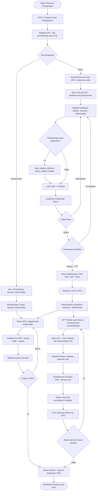
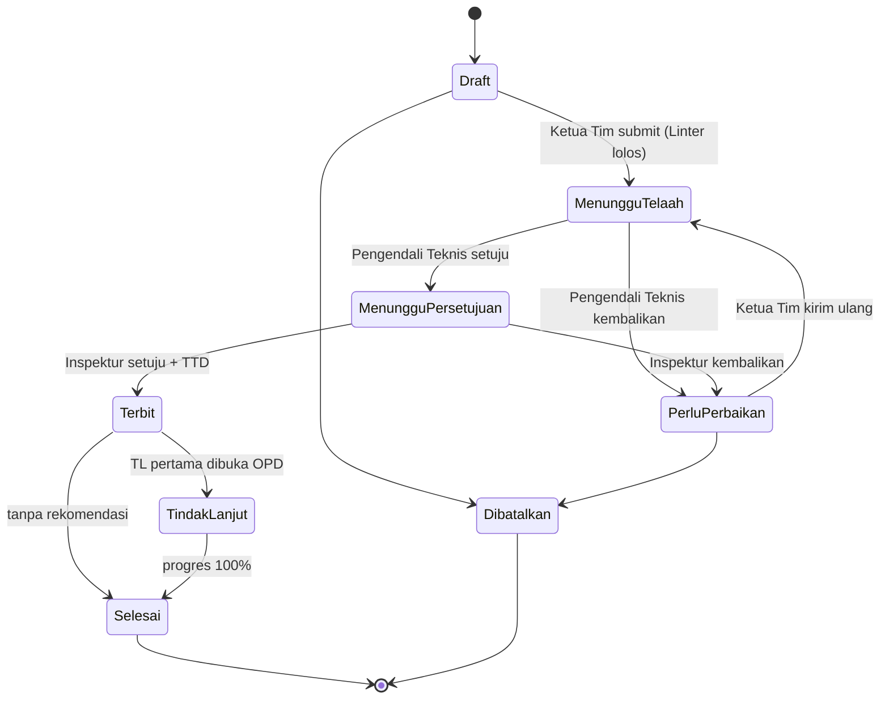
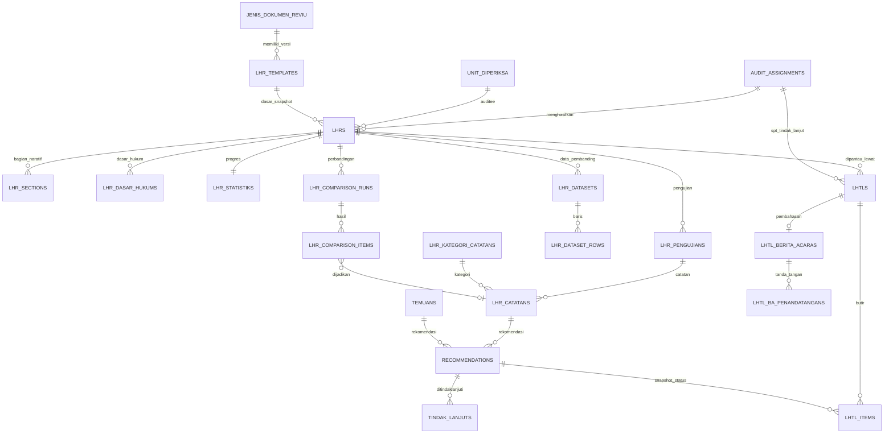

# PRD — SIMANTAB v2: Integrasi Modul Laporan Hasil Reviu (LHR)

| | |
|---|---|
| **Produk** | SIMANTAB — Sistem Informasi Manajemen Tindak Lanjut dan Pengawasan (Inspektorat Daerah) |
| **Fitur baru** | Modul Reviu Dokumen Perencanaan & Keuangan Daerah → menghasilkan **LHR** |
| **Versi dokumen** | 1.1 (draft untuk review) — v1.1 menambah kategori **LHTL** (Laporan Hasil Tindak Lanjut Reviu) + Berita Acara dan jenis dokumen KUA-PPAS |
| **Tanggal** | 21 September 2026 |
| **Sumber** | (1) Analisis sistem SIMANTAB berjalan (`implementation_plan.md`); (2) tiga LHR referensi Inspektorat Kab. Rembang: Rankir RKPD 2027, Rankir Renstra BPPKAD 2025-2029, SHSD 2027; (3) dua LHTL referensi (BPPKAD): LHTL Reviu Rankir Perubahan KUA-PPAS 2025 (`700/071/REVIU/INSP/2025`) dan LHTL Reviu Rankir KUA-PPAS 2026 (`700/113/REVIU/INSP/2025`, beserta Berita Acara). Semua referensi berupa hasil scan yang saya baca dengan OCR — nomor, angka, dan tanggal perlu diverifikasi pada dokumen asli. |
| **Status asumsi** | Skema tabel eksisting **belum saya lihat langsung** (hanya deskripsi di `implementation_plan.md`). Semua perubahan pada tabel eksisting ditandai ⚠ dan wajib dicocokkan dengan migrasi aktual sebelum dikerjakan. |

---

## 1. Ringkasan Eksekutif

SIMANTAB saat ini mendigitalkan siklus **pemeriksaan (audit)**: PKPT → SPT → LHP → temuan → rekomendasi → tindak lanjut OPD → verifikasi → Laporan Kepatuhan.

Inspektorat juga menghasilkan produk pengawasan lain yang belum tercakup: **reviu** atas dokumen perencanaan dan keuangan daerah (RKPD, Renstra, SHSD, dan dokumen lain dalam lingkup Permendagri 3/2026 seperti KUA-PPAS, RAPBD, ASB, LKPD). Hasilnya adalah **LHR** yang saat ini disusun manual (Word/scan PDF).

**Tujuan PRD ini:** menambahkan modul LHR ke SIMANTAB sebagai *tahapan fitur baru* yang:

1. memakai ulang fondasi yang sudah ada (PKPT, SPT, tim, OPD, rekomendasi, tindak lanjut, verifikasi, dashboard, tracking, audit trail, PDF/QR);
2. menghasilkan dokumen **LHR dan LHTL (+ Berita Acara)** yang **format dan isinya setara dengan referensi**, digenerate dari data terstruktur;
3. dibangun dengan skema data yang bersih, cepat, aman, dan mudah dipakai.

**Prinsip inti desain:** LHR bukan "LHP dengan kolom tambahan". Reviu memberi *keyakinan terbatas* atas dokumen (catatan + rekomendasi perbaikan, tanpa kerugian negara), sehingga dimodelkan sebagai **agregat terpisah** yang **berbagi pipeline rekomendasi → tindak lanjut → verifikasi** dengan LHP.

**Kategori ketiga (v1.1): LHTL.** Setelah LHR terbit, Inspektorat memantau tindak lanjut OPD lewat *monitoring dan pendampingan*, lalu menerbitkan **LHTL** (dan pada siklus KUA-PPAS 2026, juga **Berita Acara** pembahasan bersama OPD). LHTL adalah *potret status pada tanggal tertentu* dari rekomendasi LHR, sehingga dimodelkan sebagai **snapshot yang tidak berubah** yang dibangkitkan dari data tindak lanjut hidup — bukan diketik ulang.

---

## 2. Latar Belakang & Masalah

### 2.1 Kondisi saat ini
| Area | Kondisi |
|---|---|
| Pemeriksaan (LHP) | Terdigitalisasi penuh di SIMANTAB |
| Reviu (LHR) | Manual; tidak ada penugasan, checklist, penomoran, maupun pelacakan tindak lanjut di sistem |
| Bukti perbandingan data | Ditautkan lewat tautan eksternal (mis. bit.ly) dan "data barang terlampir" — sulit diaudit dan rawan hilang |
| Tindak lanjut reviu | Laporan ditutup dengan "mohon ditindaklanjuti" tanpa mekanisme pemantauan |
| Pemantauan tindak lanjut (LHTL) | Disusun manual: rekomendasi disalin dari LHR, status dan realisasi diketik, bukti berupa tautan eksternal (bit.ly); Berita Acara dibuat terpisah |

### 2.2 Masalah yang teramati pada laporan referensi
Temuan ini menjadi dasar aturan validasi otomatis (Lampiran E):
- Tahun tidak konsisten di dalam teks (rekomendasi RKPD menyebut "tahun 2026" padahal objeknya 2027; simpulan SHSD menyebut "2026" padahal objeknya 2027).
- Penomoran simpulan dan rekomendasi tidak sejajar sehingga sulit dilacak silang (RKPD: simpulan 1–8, rekomendasi 1–7 karena pengujian yang "sesuai" tidak punya rekomendasi; judul butir juga sedikit berbeda antar bagian).
- Format penomoran surat tidak seragam (SPT `000.1.2.3/020/INSP/2026` vs `000.1.2.3/026/REVIU/INSP/2026`; LHR `700/093.a/…` dengan sufiks huruf).
- Jabatan orang yang sama ditulis berbeda antar laporan.
- Bukti (data barang, perbandingan tabel) tidak terikat ke catatan yang merujuknya.
- **LHTL — objek dan tanggal tidak cocok dengan laporannya sendiri.** LHTL Perubahan KUA-PPAS 2025 bertanggal 21 Juli 2025, tetapi teks pelaksanaannya menyebut "RKPD 2026" dan SPT tertanggal 25 September 2025 (tanggal yang belum terjadi saat laporan terbit); tampak sisa salin-tempel dari siklus lain.
- **LHTL — ringkasan status tidak selaras dengan tabel.** Pada LHTL Perubahan KUA-PPAS 2025, tabel memuat 6 butir *belum selesai* sedangkan daftar "Status Tindak Lanjut" hanya 5. Pada LHTL KUA-PPAS 2026, kalimat penutup menyebut 5 rekomendasi masih dalam proses, daftar memuat 3, dan tabel (menurut pembacaan OCR saya) menunjukkan 4 butir berstatus proses. *(Pembacaan OCR; cek kembali pada dokumen asli.)*
- **Status tindak lanjut ditulis bebas** ("Selesai", "Belum selesai", "Proses koordinasi dengan Bappeda", "tidak dapat ditindaklanjuti") tanpa daftar baku; satu butir yang jelas *sebagian* (program prioritas sudah berindikator tetapi belum dipilah induk/perubahan) dilabeli *belum selesai*.
- **Bukti tindak lanjut berupa tautan singkat eksternal** (bit.ly) yang dapat mati atau berubah, tanpa jejak versi.
- **Kode pada nomor laporan berganti-ganti**: LHR asal ditulis `700/031/LHR/INSP/2025` pada satu rujukan, tetapi `700/102/REVIU/INSP/2025` pada rujukan lain.

---

## 3. Tujuan, Non-Tujuan, dan Metrik Keberhasilan

### 3.1 Tujuan
| # | Tujuan |
|---|---|
| G1 | LHR terbit dari sistem dengan struktur & bahasa setara referensi (RKPD, Renstra, SHSD) |
| G2 | Satu alur end-to-end untuk dua produk pengawasan (LHP dan LHR) dengan dashboard, tracking, dan audit trail bersama |
| G3 | Tindak lanjut LHR terpantau seperti LHP (OPD unggah dokumen revisi → auditor verifikasi → progres otomatis) |
| G4 | Mengurangi kesalahan manual lewat *LHR Linter* dan template terversi |
| G5 | Menjaga performa dan keamanan SIMANTAB eksisting (tanpa regresi) |
| G6 | LHTL dan Berita Acara terbit dari data tindak lanjut hidup (snapshot), tanpa menyalin-tempel rekomendasi maupun mengetik ulang status |

### 3.2 Non-tujuan (versi ini)
- Tidak mengganti alur LHP/temuan/kerugian negara yang sudah berjalan.
- Tidak membuat aplikasi mobile native (web responsif saja).
- Tidak menyediakan API publik/terbuka pihak ketiga.
- Tidak melakukan penilaian substansi otomatis (sistem mendeteksi *selisih data*; **penilaian tetap oleh auditor**).
- Tidak mengintegrasikan langsung ke SIPD-RI (impor via berkas Excel/CSV).

### 3.3 Metrik keberhasilan
Baseline belum diukur; ukur dulu 1-2 reviu berjalan sebelum menetapkan target final.

| Metrik | Target awal (usulan) |
|---|---|
| Waktu dari SPT sampai LHR terbit | Turun ≥ 40% dari baseline |
| LHR terbit dengan inkonsistensi tahun/penomoran/tim | 0 |
| Catatan tanpa rekomendasi pada LHR terbit | 0 |
| LHR terbit ber-QR verifikasi & hash dokumen | 100% |
| p95 waktu respons halaman daftar & detail | < 500 ms |
| Dashboard (data ter-cache) | < 1 detik |
| Generate PDF LHR ≤ 60 halaman (async) | ≤ 30 detik |
| Rasio rekomendasi LHR selesai tepat waktu | Dipantau; target ditetapkan setelah SLA disepakati |
| Selisih antara ringkasan status LHTL dan tabelnya | 0 (dihitung otomatis) |
| Waktu dari SPT tindak lanjut sampai LHTL terbit | Dipantau; referensi menunjukkan ± 10 hari dari SPT tindak lanjut, dan 10–16 hari dari LHR |

---

## 4. Pengguna & Peran

### 4.1 Peran (6 eksisting + 1 baru)
| Role | Kode | Perubahan untuk modul LHR |
|---|---|---|
| Super Admin | `super_admin` | + Kelola master jenis dokumen, template, format penomoran, kategori catatan |
| Kepala Inspektorat | `kepala_inspektorat` | + Persetujuan akhir & penandatanganan LHR |
| **Pengendali Teknis (Irban)** | **`pengendali_teknis` (BARU)** | Kendali mutu: menelaah LHR, mengembalikan atau meneruskan ke Inspektur; memverifikasi tindak lanjut LHR unit binaannya |
| Ketua Tim | `ketua_tim` | + Membuat & menyusun LHR, submit untuk telaah |
| Anggota Tim | `anggota` | + Mengisi pengujian/catatan yang ditugaskan |
| Staff Inspektorat | `staff_inspektorat` | + Registrasi permohonan reviu, SPT reviu, distribusi LHR |
| OPD (Auditee) | `opd` | + Ajukan permohonan reviu; terima LHR terbit; kirim tindak lanjut dokumen revisi |

> Referensi: laporan RKPD/Renstra/SHSD menyebut struktur tim *Penanggung Jawab (Inspektur) – Pengendali Teknis (Irban I) – Ketua Tim – Anggota*. Karena itu role Pengendali Teknis dipisah dari `ketua_tim`.

> LHTL memakai struktur tim yang sama, tetapi **anggota dan ketua tim dapat berbeda** dari LHR asalnya (ketua tim berganti antar laporan pada referensi). Karena itu tim LHTL selalu diambil dari **SPT tindak lanjut**-nya sendiri. Berita Acara ditandatangani **pimpinan OPD** (mis. Kepala BPPKAD) bersama tim; ini dimodelkan sebagai permission `ba.confirm` pada akun pimpinan OPD, bukan role baru.

### 4.2 Persona ringkas
| Persona | Kebutuhan utama | Rasa sakit saat ini |
|---|---|---|
| Ketua Tim reviu | Menyusun LHR cepat, format benar, tidak mengetik ulang | Salin-tempel antar laporan, salah tahun/nomor |
| Anggota tim | Tahu pengujian mana yang jadi tugasnya, input mudah | Koordinasi lewat berkas Word bergantian |
| Irban / Inspektur | Menelaah & menyetujui dengan cepat, jejak jelas | Membaca dokumen panjang tanpa ringkasan mutu |
| Staff | Nomor & distribusi tertib | Penomoran manual, surat tersebar |
| PIC OPD | Tahu persis apa yang harus diperbaiki & sampai kapan | Rekomendasi tersebar di PDF, tidak ada pengingat |

---

## 5. Konsep Domain Gabungan

### 5.1 Perbandingan LHP vs LHR
| Aspek | LHP (eksisting) | LHR (baru) |
|---|---|---|
| Sifat | Pemeriksaan / audit | Reviu — keyakinan terbatas atas dokumen |
| Objek | Unit/kegiatan (desa, sekolah, dinas…) | Dokumen (RKPD, Renstra, SHSD, …) milik OPD |
| Unit hasil | Temuan (kondisi, sebab, akibat, kerugian) | Pengujian → catatan → simpulan |
| Rekomendasi | Uang / Barang / Administrasi | Selalu perbaikan dokumen (kategori Administrasi) |
| Nilai uang & cicilan | Ya | **Tidak** |
| Tindak lanjut | Bukti setor, SOP, BA | Dokumen revisi + tanggapan |
| SLA | 60 hari | Dikonfigurasi per jenis dokumen (reviu umumnya terikat jadwal penyusunan KUA-PPAS/APBD) |
| Progres | % rekomendasi + % nilai uang | % rekomendasi |
| Laporan turunan | Laporan Kepatuhan | Bagian baru di Laporan Kepatuhan (informasional) |

### 5.2 Yang dipakai ulang vs dibuat baru
| Dipakai ulang | Dibuat baru |
|---|---|
| `AuditProgram`/`Detail` (PKPT), `AuditAssignment` (SPT) + tim + unit | Master jenis dokumen & **template terversi** |
| `UnitDiperiksa` (OPD) | Agregat `Lhr` + bagian, dasar hukum, pengujian, catatan |
| `Recommendation` → `TindakLanjut` → verifikasi | Mesin perbandingan data (dataset, aturan, hasil) |
| `Attachment`, ActivityLog, Spatie RBAC | Penomoran atomik, generator PDF/DOCX LHR, LHR Linter |
| Dashboard, `/tracking`, QR & tanda tangan digital | Role Pengendali Teknis, portal permohonan reviu |

### 5.3 Keputusan Arsitektur Utama (ADR-01): bagaimana LHR menempel ke pipeline rekomendasi

| Opsi | Uraian | Keputusan |
|---|---|---|
| A. **Agregat LHR terpisah + `recommendations` dapat menunjuk temuan *atau* catatan LHR** | Dua FK nullable + `CHECK` tepat satu terisi | **Dipilih** — integritas FK terjaga, pipeline TL/verifikasi/dashboard dipakai ulang, migrasi kecil |
| B. Satu tabel `lhps` dengan kolom `jenis` | Banyak kolom nullable (kerugian, kondisi/sebab/akibat) | Ditolak — skema kotor, semantik berbeda |
| C. Modul reviu mandiri termasuk tindak lanjut sendiri | Duplikasi logika verifikasi & dashboard | Ditolak — biaya pemeliharaan ganda |

Konsekuensi ⚠: semua query eksisting yang membaca `recommendations` harus diaudit agar tidak ikut menghitung rekomendasi LHR secara tidak sengaja (gunakan scope `forTemuan()` / `forLhrCatatan()`).

### 5.4 Kategori ketiga (v1.1): LHTL dan Berita Acara

Setelah LHR terbit, OPD menindaklanjuti rekomendasi; Inspektorat melakukan *monitoring dan pendampingan* lalu menerbitkan **Laporan Hasil Tindak Lanjut (LHTL)**. Pada referensi siklus KUA-PPAS 2026, hasil pembahasan bersama OPD juga dituangkan dalam **Berita Acara** yang ditandatangani pimpinan OPD dan tim.

| Aspek | LHR | LHTL |
|---|---|---|
| Tujuan | Keyakinan terbatas atas dokumen | Memantau pelaksanaan rekomendasi LHR |
| Sumber isi | Pengujian & catatan yang diinput auditor | Rekomendasi LHR (**otomatis**) + status, realisasi, bukti dari tindak lanjut OPD |
| Penugasan | SPT reviu | **SPT tindak lanjut** tersendiri (nomor & tanggal sendiri; tim dapat berbeda) |
| Sifat data | Isi laporan | **Potret status pada tanggal terbit** (immutable) |
| Putaran | Satu (revisi bila perlu) | Dapat lebih dari satu putaran sampai semua butir tuntas |
| Penandatangan | Inspektur | Inspektur + tim tindak lanjut; Berita Acara: pimpinan OPD + tim |
| Referensi | RKPD, Renstra, SHSD | LHTL Perubahan KUA-PPAS 2025; LHTL KUA-PPAS 2026 (+ Berita Acara) |

**ADR-02 — cara memodelkan LHTL**
| Opsi | Uraian | Keputusan |
|---|---|---|
| A. **Agregat snapshot** `lhtls` + `lhtl_items`, dibangkitkan dari rekomendasi & tindak lanjut hidup lalu dikunci saat terbit | Laporan mencerminkan keadaan pada tanggal terbit; status hidup tetap di alur TL | **Dipilih** |
| B. LHTL sebagai *view* live yang dicetak | Angka berubah setelah laporan terbit | Ditolak |
| C. LHTL diketik bebas seperti sekarang | Salin-tempel; ringkasan bisa tidak selaras dengan tabel | Ditolak |

**Status tindak lanjut baku** (dari istilah yang teramati di dua LHTL)
| Kode | Arti | Contoh di referensi | Dihitung selesai? |
|---|---|---|---|
| `selesai` | Diverifikasi tuntas | "Selesai" | Ya |
| `sebagian` | Sebagian dipenuhi | Program prioritas sudah berindikator tetapi belum dipilah induk/perubahan | Tidak |
| `dalam_proses` | Sedang dikerjakan, termasuk menunggu pihak lain | "Proses koordinasi dengan Bappeda / TAPD", "proses" | Tidak |
| `belum_selesai` | Belum dikerjakan | "Belum selesai" | Tidak |
| `tidak_dapat_ditindaklanjuti` | Tidak dapat dilakukan OPD karena bergantung pada pihak/sistem lain | Data tarikan SIPD-RI yang bersumber dari RKPD | Lihat OQ-10 |

`tidak_dapat_ditindaklanjuti` wajib disertai alasan dan persetujuan Pengendali Teknis.

---

## 6. Cakupan & Fase Rilis

| Fase | Isi | Kriteria selesai |
|---|---|---|
| **F0 — Fondasi** | ADR, audit query `recommendations`, role `pengendali_teknis`, migrasi expand-only, service penomoran atomik, `assignment.tipe` | Tes regresi LHP hijau; tidak ada perubahan perilaku LHP |
| **F1 — MVP LHR (SHSD)** | Master + template SHSD, buat LHR dari SPT, pengujian/catatan/simpulan/rekomendasi, Linter dasar, workflow persetujuan, PDF + QR, penomoran | LHR SHSD 2027 direproduksi dari data seed; teks sama dengan referensi (golden test) |
| **F2 — RKPD, Renstra & KUA-PPAS** | Layout dua kolom (tabel catatan–rekomendasi), penomoran bagian romawi/alfabet, sub-pengujian bersarang, ekspor DOCX, pengiriman ke OPD; template KUA-PPAS & Perubahan KUA-PPAS (**bergantung pada LHR asalnya**, OQ-13) | Tiga LHR referensi lolos golden test; template KUA-PPAS terverifikasi terhadap LHR asal |
| **F3 — Tindak lanjut, LHTL & Portal OPD** | TL LHR, dokumen revisi, SLA & pengingat, statistik progres, permohonan reviu OPD, **SPT tindak lanjut, LHTL (snapshot), Berita Acara**, `/tracking` & `/verifikasi` | OPD dapat menyelesaikan siklus penuh; kedua LHTL referensi lolos golden test |
| **F4 — Perbandingan data** | Impor dataset, aturan (SHSD ±15%, ganda; RKPD vs RPJMD), "Jadikan catatan", ekspor lampiran | Impor 5.000 baris < 60 dtk; hasil dapat dijadikan catatan |
| **F5 — Analitik & hardening** | Dashboard gabungan, seksi reviu di Laporan Kepatuhan, catatan berulang, uji beban, review keamanan, UAT | Semua NFR (Bagian 10) terpenuhi |

> Urutan F3 dan F4 dapat ditukar bila tim reviu lebih membutuhkan perbandingan data daripada portal OPD.

---

## 7. Kebutuhan Fungsional

Prioritas: **M** = Must, **S** = Should, **C** = Could.

### 7.1 Master & Template (TPL)
| ID | Kebutuhan | Prio | Kriteria penerimaan |
|---|---|---|---|
| TPL-01 | Master **jenis dokumen reviu** (RKPD, RENSTRA, SHSD, RPJMD, KUA_PPAS, RAPBD, ASB, LKPD) | M | Super admin dapat CRUD; kode unik |
| TPL-02 | **Template terversi** per jenis: daftar pengujian, dasar hukum default, bagian naratif, opsi simpulan. Publish membuat versi *immutable* | M | Mengubah template **tidak** mengubah LHR yang sudah dibuat (LHR menyimpan salinan/snapshot) |
| TPL-03 | Placeholder aman: `{{opd}}`, `{{tahun}}`, `{{nomor_spt}}`, `{{tanggal_mulai}}`, `{{tanggal_selesai}}`, `{{jenis_dokumen}}` | M | Hanya whitelist yang diganti; placeholder tak dikenal ditolak saat publish; **tidak ada evaluasi Blade/kode dari isi database** |
| TPL-04 | Seed template RKPD, RENSTRA, SHSD dari referensi (Lampiran A) | M | Seeder idempoten |
| TPL-05 | Master **kategori catatan** (format, kelengkapan dokumen, konsistensi RPJMD, kewajaran harga, dll.) | S | Setiap catatan wajib berkategori (dipakai analitik) |
| TPL-06 | Konfigurasi format penomoran & SLA tindak lanjut per jenis | M | Perubahan format tidak mengubah nomor yang sudah terbit |

### 7.2 Permohonan & Penugasan (INT)
| ID | Kebutuhan | Prio | Kriteria penerimaan |
|---|---|---|---|
| INT-01 | OPD mengajukan **Permohonan Reviu** di portal (jenis dokumen, tahun, surat permohonan, dokumen rankir) | S | Staff menerima notifikasi; berkas tersimpan privat |
| INT-02 | Staff meregistrasi permohonan manual (surat kertas) | M | Nomor & tanggal surat tercatat |
| INT-03 | SPT bertipe **reviu**, tertaut ke rincian PKPT; satu SPT boleh meliputi banyak OPD | M | Tim (pengendali teknis, ketua, anggota) & jadwal dipakai otomatis di LHR |
| INT-04 | **Buat LHR dari SPT** — tunggal atau massal (OPD × jenis dokumen) | M | Template termuat, pengujian ter-*seed*, bagian terisi placeholder |
| INT-05 | Guard tipe penugasan: SPT reviu tidak dapat menghasilkan LHP, dan sebaliknya | M | Validasi di service + tes |
| INT-06 | Wizard pembuatan 3 langkah (OPD & dokumen → penugasan & jadwal → tinjau) | S | Selesai < 2 menit tanpa mengetik ulang data SPT |

### 7.3 Penyusunan LHR (LHR)
| ID | Kebutuhan | Prio | Kriteria penerimaan |
|---|---|---|---|
| LHR-01 | Halaman kerja LHR: daftar pengujian, status simpulan, progres % | M | Progres = pengujian tersimpulkan / total |
| LHR-02 | Penugasan pengujian ke anggota tim | S | Anggota hanya melihat & mengedit pengujian yang ditugaskan (Ketua melihat semua) |
| LHR-03 | Catatan: kategori, referensi bagian (mis. "BAB III / 3.2"), isi teks terformat terbatas, lampiran | M | HTML disanitasi saat simpan; urutan dapat diubah |
| LHR-04 | Simpulan per pengujian: status (`sesuai`, `sebagian_sesuai`, `belum_sesuai`, `tidak_berlaku`) + teks; teks awal dari template, dapat diedit | M | Pengujian tak berstatus menghalangi submit |
| LHR-05 | Rekomendasi per catatan (memakai `Recommendation`), batas waktu default dari SLA jenis dokumen | M | Catatan tanpa rekomendasi memicu peringatan Linter |
| LHR-06 | Edit bagian naratif (Gambaran Umum, Ringkasan Eksekutif, Pernyataan, dll.) | M | Bagian terkunci bila status ≥ Terbit |
| LHR-07 | **Autosave** draft + *optimistic locking* (`version`) | M | Dua pengguna mengedit bersamaan → peringatan konflik, tidak menimpa diam-diam |
| LHR-08 | **LHR Linter** — validasi sebelum submit (Lampiran E) | M | Galat memblokir submit; peringatan tidak |
| LHR-09 | **Pratinjau** HTML yang sama strukturnya dengan PDF | M | Pratinjau bertanda air "DRAFT" |
| LHR-10 | Sub-pengujian bersarang (mis. 6a–6e pada RKPD) | M | Kedalaman maksimal 2 tingkat |
| LHR-11 | Riwayat perubahan catatan/simpulan (siapa, kapan, sebelum-sesudah) | S | Bersumber dari ActivityLog |

### 7.4 Alur Persetujuan & Penerbitan (WF)
| ID | Kebutuhan | Prio | Kriteria penerimaan |
|---|---|---|---|
| WF-01 | State machine LHR (Bagian 8.2) | M | Transisi ilegal ditolak; setiap transisi tercatat |
| WF-02 | Pengendali Teknis / Inspektur dapat **mengembalikan dengan catatan per bagian** | M | Catatan pengembalian terlihat oleh Ketua Tim |
| WF-03 | **Penomoran otomatis saat terbit** (atomik, tanpa lubang nomor untuk draft) | M | Tes konkurensi: 50 permintaan paralel → nomor unik & berurutan |
| WF-04 | Generate **PDF final asinkron**, simpan di disk privat, catat `sha256`, sisipkan QR verifikasi | M | PDF final tidak dapat ditimpa; unduh lewat URL bertanda tangan |
| WF-05 | Penandatanganan: mengikuti mekanisme tanda tangan digital SIMANTAB saat ini; opsi TTE tersertifikasi (BSrE) sebagai pengembangan | M / C | Penandatangan & waktu tercatat |
| WF-06 | Setelah **Terbit**, konten terkunci; perubahan hanya lewat **revisi** (versi baru, nomor sesuai kebijakan) | M | Upaya edit langsung ditolak di level service & policy |
| WF-07 | Ekspor **DOCX** draft untuk penyuntingan luar sistem | S | Struktur judul & tabel terjaga |
| WF-08 | Distribusi ke OPD + notifikasi | M | OPD hanya melihat LHR berstatus ≥ Terbit untuk unitnya |

### 7.5 Tindak Lanjut OPD atas LHR (TL)
| ID | Kebutuhan | Prio | Kriteria penerimaan |
|---|---|---|---|
| TL-01 | LHR terbit tampil di menu Tindak Lanjut OPD (hanya unit sendiri) | M | Uji IDOR lolos |
| TL-02 | OPD mengirim tanggapan + **dokumen revisi** (berversi); saat dikirim, form terkunci | M | Perilaku sama dengan TL LHP |
| TL-03 | Auditor memverifikasi: diterima / ditolak (+ alasan, membuka kunci) | M | Reuse alur verifikasi eksisting |
| TL-04 | SLA per jenis dokumen; pengingat H-7 / H-3 / jatuh tempo (email/WhatsApp) | M | Nilai SLA & jadwal pengingat dapat dikonfigurasi |
| TL-05 | Statistik progres LHR (event-driven, tersimpan di `lhr_statistiks`) | M | Diperbarui pada setiap verifikasi tanpa hitung ulang saat halaman dibuka |
| TL-06 | Status LHR otomatis **Selesai** saat 100%; LHR tanpa rekomendasi langsung Selesai | M | Tercatat di audit trail |
| TL-07 | Status tindak lanjut baku 5 nilai (Bagian 5.4) pada rekomendasi LHR; `tidak_dapat_ditindaklanjuti` wajib alasan + persetujuan Pengendali Teknis | M | Perubahan tercatat; status tercermin di dashboard |
| TL-08 | Kolom `pihak_terkait` dan `kendala` untuk butir yang bergantung pihak lain (Bappeda, TAPD, dll.) | S | Tampil di LHTL |

### 7.5A LHTL & Berita Acara (LTL) — v1.1
| ID | Kebutuhan | Prio | Kriteria penerimaan |
|---|---|---|---|
| LTL-01 | **SPT tindak lanjut reviu** (`assignment.tipe = tindak_lanjut_reviu`) tertaut ke LHR asal; tim serta nomor/tanggal SPT diambil dari SPT ini | M | LHTL tidak dapat dibuat tanpa SPT TL dan LHR berstatus ≥ Terbit |
| LTL-02 | **Buat LHTL dari LHR**: seluruh rekomendasi LHR menjadi butir LHTL otomatis, bernomor hierarkis (1, 1.a, 6.b.2) mengikuti struktur pengujian/catatan | M | Tidak ada butir yang diketik ulang; teks rekomendasi tersalin sebagai snapshot |
| LTL-03 | Setiap butir menyimpan snapshot: status TL, realisasi (dari tanggapan OPD, dapat disunting auditor), rujukan lokasi (bab/halaman dokumen OPD), bukti, pihak terkait, kendala | M | Perubahan TL hidup setelah terbit **tidak** mengubah LHTL yang sudah terbit |
| LTL-04 | **Ringkasan status otomatis**: bagian "Status Tindak Lanjut" (daftar butir belum tuntas) dan kalimat kesimpulan ("… terdapat n rekomendasi masih dalam proses …") dihitung dari butir, bukan diketik | M | Jumlah di kalimat = jumlah di daftar = jumlah pada tabel (dijaga tes otomatis) |
| LTL-05 | **Putaran**: satu LHR dapat memiliki beberapa LHTL (putaran 1, 2, …) bernomor sendiri; putaran terbaru dipakai dashboard | S | Butir yang sudah `selesai` tetap tampil selesai di putaran berikutnya |
| LTL-06 | Bukti berupa lampiran internal berkode (mis. `B-6.b`) di disk privat; LHTL menampilkan kode + bendel bukti. Tautan eksternal hanya sebagai teks rujukan (https saja, tidak diambil server) | M | Tidak ada tautan bebas sebagai satu-satunya bukti |
| LTL-07 | **Berita Acara Tindak Lanjut** dibangkitkan dari snapshot yang sama: hari/tanggal, tempat, nomor LHR asal, tabel hasil, penandatangan (pimpinan OPD sebagai *Yang Menerangkan* + Pengendali Teknis, Ketua Tim, Anggota) | S | Nama/NIP/jabatan penandatangan berupa snapshot; status `menunggu_ttd_opd` → `lengkap` |
| LTL-08 | Persetujuan LHTL memakai state machine yang sama dengan LHR (Bagian 8.2); penomoran, PDF, QR, dan hash memakai layanan yang sama | M | Satu implementasi workflow generik, tanpa duplikasi kode |
| LTL-09 | Template LHTL terversi (latar belakang, kalimat penutup berdasar SAIPI, tabel 5 kolom) | M | Tampilan setara dua referensi LHTL |
| LTL-10 | **LHTL Linter** (L-13 s.d. L-19, Lampiran E) | M | Galat memblokir submit |
| LTL-11 | Setelah terbit: dikirim ke OPD; butir yang belum tuntas otomatis menjadi antrean putaran berikutnya | S | Notifikasi & tenggat mengikuti SLA (OQ-02) |

### 7.6 Perbandingan Data (CMP) — Fase 4
| ID | Kebutuhan | Prio | Kriteria penerimaan |
|---|---|---|---|
| CMP-01 | Impor Excel/CSV ke *dataset* (per LHR, berlabel sumber: RPJMD, SIPD, Rankir, SHS Regional, SHSD tahun lalu) lewat antrean, per potongan (chunk) | S | 5.000 baris < 60 detik; galat baris dilaporkan per baris |
| CMP-02 | Pemetaan kolom & **kunci normalisasi** (huruf kecil, spasi rapat, kode barang) | S | Pemetaan dapat disimpan sebagai preset |
| CMP-03 | Mesin aturan: `cocok`, `beda_nilai`, `hilang_kiri`, `hilang_kanan`, `ganda`; aturan bawaan SHSD (naik > 15% / turun vs tahun lalu, satuan berbeda) dan RKPD (program/indikator/target/pagu berbeda) | S | Aturan berupa kelas terpisah (`ComparisonRule`), mudah ditambah |
| CMP-04 | Tombol **"Jadikan catatan"** (satuan/massal) — catatan terhubung ke butir hasil sebagai bukti | S | Butir berstatus `dijadikan_catatan` & tertaut |
| CMP-05 | Ekspor hasil ke Excel sebagai **lampiran LHR** ("bendel") | S | Lampiran terikat ke LHR & terunduh dari halaman LHR |
| CMP-06 | Retensi: baris mentah dataset dihapus N hari setelah LHR Selesai (ringkasan tetap) | C | Dijalankan scheduler |

### 7.7 Dashboard, Publik, Ekspor
| ID | Kebutuhan | Prio |
|---|---|---|
| DSH-01 | Dashboard Inspektorat gabungan LHP + LHR + LHTL: jumlah per jenis/status, waktu siklus, beban kerja auditor, item jatuh tempo | S |
| DSH-02 | Dashboard OPD memuat LHR siap diunduh & rekomendasi LHR yang harus ditindaklanjuti | M |
| DSH-03 | Laporan Kepatuhan: seksi "Hasil Reviu" (informasional; tidak memblokir penerbitan — lihat OQ-04) | S |
| DSH-04 | Analitik catatan berulang per kategori & jenis dokumen lintas tahun | C |
| PUB-01 | `/tracking` menerima nomor LHR/LHTL; hanya menampilkan jenis dokumen, OPD, tahun, status, progres % (tanpa isi) | M |
| PUB-02 | `/verifikasi/{uuid}` dari QR: nomor, tanggal, penandatangan, status hash valid/tidak | M |
| EXP-01 | Ekspor Excel rekap LHR & catatan (filter tahun, OPD, jenis, status) | S |

### 7.8 Administrasi & Keamanan (ADM)
| ID | Kebutuhan | Prio |
|---|---|---|
| ADM-01 | Role `pengendali_teknis` + permission granular (Lampiran D) | M |
| ADM-02 | Audit trail seluruh transisi status; log tidak dapat diubah dari UI | M |
| ADM-03 | 2FA (TOTP) untuk Kepala Inspektorat, Pengendali Teknis, Super Admin | S |
| ADM-04 | Pengelolaan sequence & format penomoran (hanya super admin, tercatat) | M |

---

## 8. Alur Kerja Gabungan

### 8.1 Alur end-to-end (LHP + LHR + LHTL)


### 8.2 State machine LHR


| Dari → Ke | Aktor | Prasyarat |
|---|---|---|
| Draft → Menunggu Telaah | `ketua_tim` (tim penugasan) | Linter tanpa galat, semua pengujian tersimpulkan |
| Menunggu Telaah → Menunggu Persetujuan / Perlu Perbaikan | `pengendali_teknis` | Alasan wajib bila dikembalikan |
| Menunggu Persetujuan → Terbit | `kepala_inspektorat` | Nomor dialokasikan **di dalam transaksi yang sama**; PDF final di-*queue* |
| Terbit → Tindak Lanjut | sistem | Rekomendasi pertama dikirim OPD |
| Tindak Lanjut → Selesai | sistem | 100% rekomendasi terverifikasi |
| Revisi setelah Terbit | `ketua_tim` + persetujuan ulang | Membuat versi baru (`revisi_dari_id`); versi lama tetap tersimpan |

### 8.3 Alur LHTL & Berita Acara (v1.1)
LHTL memakai state machine yang sama (Draft → Menunggu Telaah → Menunggu Persetujuan → Terbit), ditambah langkah Berita Acara:

1. Staff/Ketua menerbitkan **SPT tindak lanjut reviu** yang menunjuk LHR asal.
2. Ketua Tim membuat LHTL → sistem membangkitkan butir dari rekomendasi LHR beserta status, realisasi, dan bukti terkini.
3. Tim melakukan monitoring & pendampingan; auditor melengkapi realisasi, rujukan lokasi, dan status (perubahan ke `tidak_dapat_ditindaklanjuti` perlu persetujuan Pengendali Teknis).
4. Pembahasan bersama OPD → **Berita Acara** dibangkitkan dari snapshot → ditandatangani pimpinan OPD dan tim.
5. LHTL Linter → telaah Irban → persetujuan Inspektur → **Terbit** (nomor dialokasikan; PDF + QR + hash).
6. Masih ada butir belum tuntas → putaran berikutnya (kembali ke langkah 1).

Ritme yang teramati pada referensi: ± 10 hari dari SPT tindak lanjut ke LHTL, dan 10–16 hari dari LHR ke LHTL.

---

## 9. Arsitektur Data

### 9.1 Diagram relasi (entitas baru + titik sambung ke eksisting)


### 9.2 Konvensi skema (berlaku untuk semua tabel baru)
- PK `bigint unsigned` internal; kolom `uuid` (unik) untuk **semua URL & QR publik** (mencegah enumerasi/IDOR).
- Enum disimpan sebagai `varchar` + *PHP backed enum* + `CHECK` (lebih mudah dimigrasi daripada `ENUM` DB).
- Semua FK memiliki index; aturan hapus eksplisit (`restrict` untuk master & LHR, `cascade` hanya untuk anak murni seperti sections/rows dataset).
- `softDeletes` hanya pada `lhrs`, `lhr_catatans`; **tidak** pada tabel bervolume tinggi (`lhr_dataset_rows`, `lhr_comparison_items`).
- `created_by`/`updated_by` pada tabel yang diedit manusia; jejak lengkap lewat ActivityLog.
- Kolom JSON hanya untuk data yang **tidak difilter/diurutkan** (payload baris, snapshot); kolom yang dicari dijadikan kolom biasa.
- Charset `utf8mb4`; kolom tanggal bertipe `date`/`datetime` (bukan string).
- Penamaan: ikuti konvensi tabel eksisting; awalan `lhr_` untuk seluruh domain baru.

### 9.3 Spesifikasi tabel baru
**`jenis_dokumen_reviu`** — master
| Kolom | Tipe | Catatan |
|---|---|---|
| id, uuid | | |
| kode | varchar(30) unik | `RKPD`, `RENSTRA`, `SHSD`, … |
| nama | varchar(150) | |
| gaya_penomoran_bagian | varchar(10) | `alfabet` (A,B,C) atau `romawi` (I,II,III) |
| tata_letak_hasil | varchar(20) | `tabel_dua_kolom` atau `naratif` |
| sla_tindak_lanjut_hari | smallint null | null → pakai default sistem |
| aktif | boolean | |

**`lhr_templates`** — versi template (immutable setelah terbit)
| Kolom | Tipe | Catatan |
|---|---|---|
| jenis_dokumen_reviu_id | FK | unik bersama `versi` |
| versi | smallint | naik satu per publish |
| status | varchar(15) | `draft` / `terbit` / `arsip` |
| berlaku_mulai | date | |
| dasar_perubahan | varchar(255) null | mis. "Perubahan Permendagri" |

Tabel anak template: `lhr_template_pengujians` (kode, judul, grup `format`/`substansi`, urutan, `parent_id` null, `opsi_simpulan` JSON, `teks_simpulan_default`), `lhr_template_dasar_hukums` (urutan, teks), `lhr_template_sections` (kunci, judul, isi_default, urutan, `wajib`).

**`lhrs`** — agregat utama
| Kolom | Tipe | Catatan |
|---|---|---|
| id, uuid | | uuid unik |
| audit_assignment_id | FK | SPT bertipe reviu |
| unit_diperiksa_id | FK | OPD yang direviu |
| jenis_dokumen_reviu_id, lhr_template_id | FK | template = versi yang dipakai saat dibuat |
| tahun_anggaran | smallint | |
| objek_tahun_awal, objek_tahun_akhir | smallint | Renstra 2025-2029 → 2025 & 2029; RKPD 2027 → 2027 & null |
| permohonan_nomor, permohonan_tanggal | varchar / date | surat permohonan OPD |
| tahun_nomor, nomor_urut, sufiks | smallint, int, varchar(5) default `''` | unik bersama (sufiks tidak boleh NULL agar unik bekerja di MySQL) |
| nomor_lhr | varchar(64) null unik | diisi saat Terbit |
| tanggal_mulai, tanggal_selesai, tanggal_lhr | date | urutan kronologis divalidasi Linter |
| status | varchar(30) | lihat Bagian 8.2 |
| versi, revisi_dari_id | smallint, FK self null | revisi setelah Terbit |
| row_version | unsigned int | *optimistic locking* |
| ditandatangani_oleh, ditandatangani_pada | FK user, datetime | |
| dokumen_final_path, dokumen_final_sha256 | varchar, char(64) | disk privat |
| snapshot_terbit | JSON | tim (nama, NIP, jabatan **saat terbit**), dasar hukum, nama OPD, versi template |
| timestamps, softDeletes | | |

Index: `uuid`; `nomor_lhr`(unik); `(tahun_nomor, nomor_urut, sufiks)`(unik); `(unit_diperiksa_id, tahun_anggaran, jenis_dokumen_reviu_id)`; `(status, updated_at)`; `(audit_assignment_id)`; unik `(audit_assignment_id, unit_diperiksa_id, jenis_dokumen_reviu_id, versi)`.

**`lhr_sections`** (`lhr_id`, `kunci`, `judul`, `isi` mediumtext *sudah disanitasi*, `urutan`; unik `(lhr_id, kunci)`), **`lhr_dasar_hukums`** (`lhr_id`, `urutan`, `teks`).

**`lhr_pengujians`**
| Kolom | Tipe | Catatan |
|---|---|---|
| lhr_id, template_pengujian_id (null), parent_id (null) | FK | |
| kode, judul, grup, urutan | | salinan dari template, dapat disesuaikan |
| status_simpulan | varchar(20) | `belum_dinilai`, `sesuai`, `sebagian_sesuai`, `belum_sesuai`, `tidak_berlaku` |
| teks_simpulan | text | |
| ditugaskan_ke | FK user null | |
| selesai_pada | datetime null | |

Index: `(lhr_id, urutan)`, `(lhr_id, status_simpulan)`, `(ditugaskan_ke)`.

**`lhr_catatans`** (`lhr_pengujian_id`, `urutan`, `kategori_id`, `referensi_bagian` varchar(120) null, `isi` text *disanitasi*, timestamps, softDeletes, created_by) — index `(lhr_pengujian_id, urutan)`, `(kategori_id)`.
**`lhr_kategori_catatans`** (`kode` unik, `nama`, `aktif`).
**`lhr_statistiks`** (`lhr_id` unik, `total_rekomendasi`, `selesai`, `persen`, `dihitung_pada`).

**Perbandingan data (Fase 4)**
| Tabel | Kolom penting | Index |
|---|---|---|
| `lhr_datasets` | lhr_id, label, sumber, attachment_id, sha256, status (`mengantre`,`memproses`,`siap`,`gagal`), jumlah_baris, pemetaan_kolom JSON, diimpor_oleh | `(lhr_id)` |
| `lhr_dataset_rows` | dataset_id, nomor_baris, `row_key` varchar(191), payload JSON | `(dataset_id, row_key)`, `(dataset_id, nomor_baris)` |
| `lhr_comparison_runs` | lhr_id, aturan (kelas), dataset_kiri_id, dataset_kanan_id, konfigurasi JSON, status, ringkasan JSON, dijalankan_oleh | `(lhr_id)` |
| `lhr_comparison_items` | run_id, row_key, jenis_selisih, payload_kiri JSON, payload_kanan JSON, delta JSON, status_tinjau (`baru`,`dijadikan_catatan`,`diabaikan`), catatan_id null | `(run_id, jenis_selisih)`, `(run_id, status_tinjau)` |

**Tindak lanjut reviu (LHTL) — v1.1**
| Tabel | Kolom penting | Index / constraint |
|---|---|---|
| `lhtls` | id, uuid, `lhr_id` FK, `audit_assignment_id` FK (SPT TL), `unit_diperiksa_id` FK, `putaran` smallint, `tahun_nomor`/`nomor_urut`/`sufiks`, `nomor_lhtl` null, `tanggal_lhtl`, `status`, `row_version`, `ditandatangani_oleh/pada`, `dokumen_final_path`, `dokumen_final_sha256`, `snapshot_terbit` JSON (tim, nomor & tanggal LHR asal, nama OPD), `ringkasan` JSON (jumlah per status), timestamps, softDeletes | unik `(lhr_id, putaran)`; unik `nomor_lhtl`; unik `(tahun_nomor, nomor_urut, sufiks)`; `(unit_diperiksa_id, status)`; `(audit_assignment_id)` |
| `lhtl_items` | id, `lhtl_id` FK, `recommendation_id` FK, `nomor_tampil` varchar(20) (mis. `6.b.2`), `urutan` int, `rekomendasi_teks` text (snapshot), `status_tl` varchar(30), `realisasi` text *(disanitasi)*, `rujukan_lokasi` varchar(150) null, `pihak_terkait` varchar(150) null, `kendala` text null | unik `(lhtl_id, recommendation_id)`; `(lhtl_id, urutan)`; `(lhtl_id, status_tl)` |
| `lhtl_item_bukti` | `lhtl_item_id`, `attachment_id`, `kode_bukti` varchar(20) | unik `(lhtl_item_id, attachment_id)` |
| `lhtl_berita_acaras` | `lhtl_id` unik, `tanggal_pembahasan` date, `tempat` varchar(150), `nomor_ba` null, `status` (`draf`, `menunggu_ttd_opd`, `lengkap`), `dokumen_path`, `dokumen_sha256` | `(status)` |
| `lhtl_ba_penandatangans` | `berita_acara_id`, `urutan`, `peran` (`yang_menerangkan`, `pengendali_teknis`, `ketua_tim`, `anggota`), `user_id` null, `nama_snapshot`, `nip_snapshot`, `jabatan_snapshot`, `ditandatangani_pada` null | `(berita_acara_id, urutan)` |

Status LHTL sama dengan LHR (`draft` → `menunggu_telaah` → `menunggu_persetujuan` → `terbit`, plus `perlu_perbaikan`, `dibatalkan`). Template LHTL & Berita Acara memakai tabel `lhr_templates` dengan kolom baru `jenis_laporan` (`LHR`/`LHTL`/`BA`); `jenis_dokumen_reviu_id` boleh null untuk LHTL/BA (isinya generik); unik `(jenis_laporan, jenis_dokumen_reviu_id, versi)`.

**Penomoran**
| Tabel | Kolom | Catatan |
|---|---|---|
| `nomor_formats` | jenis (`lhr`, `lhtl`, `spt_reviu`, `spt_tl`, …), pola, aktif | contoh pola di Lampiran C |
| `nomor_sequences` | jenis, tahun, terakhir; unik `(jenis, tahun)` | dialokasikan `SELECT … FOR UPDATE` dalam transaksi penerbitan |

### 9.4 Perubahan pada tabel eksisting ⚠ (wajib dicocokkan dengan skema aktual)
| Tabel | Perubahan | Alasan / Risiko |
|---|---|---|
| `recommendations` | tambah `lhr_catatan_id` (FK null, index); `temuan_id` menjadi nullable; `CHECK ((temuan_id IS NULL) <> (lhr_catatan_id IS NULL))` | Berbagi pipeline TL. Risiko: query eksisting yang mengasumsikan `temuan_id` selalu ada → audit + tes regresi |
| `audit_assignments` | tambah `tipe` varchar(20) default `pemeriksaan` (`pemeriksaan` / `reviu` / `tindak_lanjut_reviu`); SPT tindak lanjut memiliki `lhr_asal_id` (FK null) | Percabangan alur & guard |
| `recommendations` (status TL) | tambah `status_tl` varchar(30) default `belum_selesai` (5 nilai, Bagian 5.4), `alasan_tidak_dapat` text null, `pihak_terkait`, `kendala`; dipelihara service saat verifikasi; index `(status_tl)` | Sumber snapshot LHTL & dashboard. Petakan ke status verifikasi eksisting (`dikirim`/`lunas`/ditolak) agar tidak ada dua sumber kebenaran (R-10) |
| `audit_program_details` | (opsional) `jenis_kegiatan` | Bila PKPT perlu membedakan reviu |
| anggota SPT (`audit_assignment_members`) | (bila belum ada) `nama_snapshot`, `nip_snapshot`, `jabatan_snapshot` | Jabatan orang yang sama berubah antar penugasan |
| `attachments` | pastikan polimorfik (`attachable_type/id`) | Lampiran LHR, dataset, dokumen revisi |
| `tindak_lanjuts` | tanpa perubahan struktur; tambah `dokumen_versi` bila belum ada | Dokumen revisi berversi |
| DB engine | `CHECK` butuh MySQL ≥ 8.0.16 / MariaDB ≥ 10.2; bila tidak, validasi di service + trigger | Lihat OQ-07 |

### 9.5 Strategi migrasi (tanpa downtime)
1. **Expand**: tambah kolom/tabel baru (nullable, tanpa mengubah perilaku lama). Rilis.
2. **Backfill**: isi `audit_assignments.tipe = 'pemeriksaan'`, snapshot anggota untuk SPT berjalan.
3. **Aktifkan** modul di balik *feature flag* (`reviu.enabled`), pilot terbatas.
4. **Contract** (nanti): pasang `CHECK` dan hilangkan asumsi lama setelah audit query selesai.
5. Setiap migrasi punya `down()` yang teruji; jalankan di salinan data produksi sebelum rilis.

### 9.6 Pola query & optimasi
| Kebutuhan | Teknik |
|---|---|
| Daftar LHR (filter OPD/tahun/jenis/status) | Index komposit di atas; paginasi server-side (`simplePaginate` untuk daftar besar); `select` kolom seperlunya |
| Detail LHR + pengujian + catatan | *Eager loading* eksplisit; `Model::preventLazyLoading()` di non-produksi agar N+1 gagal saat dev/test |
| Progres & dashboard | Baca dari `lhr_statistiks`/`lhp_statistiks`; **tidak** menghitung `COUNT` ulang per request; cache Redis 5 menit + invalidasi lewat event |
| Impor dataset | `WithChunkReading` + `WithBatchInserts` (500–1.000 baris), antrean, transaksi per chunk |
| Perbandingan | Join berbasis `row_key` (ter-index), diproses per chunk; hasil ditulis bulk |
| Laporan besar (PDF/Excel) | Selalu asinkron (queue); status dapat dipantau di UI |

---

## 10. Kebutuhan Non-Fungsional

### 10.1 Performa
| ID | Kebutuhan |
|---|---|
| NFR-P1 | p95 halaman daftar/detail < 500 ms pada 50 pengguna bersamaan (data 5 tahun) |
| NFR-P2 | Dashboard ter-cache < 1 detik; cache miss < 3 detik |
| NFR-P3 | Generate PDF ≤ 60 halaman ≤ 30 detik (asinkron); tidak memblokir request |
| NFR-P4 | Impor 5.000 baris < 60 detik; memori worker < 256 MB (chunking) |
| NFR-P5 | Tidak ada query N+1 pada halaman inti (dijaga tes) |

### 10.2 Keamanan
| Ancaman | Kontrol |
|---|---|
| Akses lintas unit / IDOR | Route memakai `uuid`; **Policy** pada setiap aksi; query dibatasi scope (OPD hanya unitnya, anggota hanya SPT-nya); OPD tidak pernah melihat LHR berstatus < Terbit |
| XSS pada catatan / bagian naratif | Teks terformat disanitasi dengan HTMLPurifier (*allowlist* tag: p, ul, ol, li, strong, em, br, table dasar) **saat simpan**; render tetap di-*escape*/dipurifikasi; CSP ketat |
| Injeksi template (SSTI) | Placeholder diganti dengan regex + whitelist; **dilarang** `Blade::render()`/`eval` pada isi database |
| Unggahan berbahaya | Validasi MIME **dan** ekstensi, batas ukuran, nama acak, disk **privat**, unduh via *signed URL* berumur pendek, opsi pemindai ClamAV, tidak pernah dieksekusi/di-*serve* langsung |
| Manipulasi dokumen terbit | Konten terkunci (policy + service), `sha256` PDF disimpan, QR ke `/verifikasi/{uuid}` menampilkan validitas hash |
| Penyalahgunaan penomoran | Alokasi atomik dalam transaksi + `UNIQUE`; hanya sistem yang mengalokasikan |
| Eskalasi hak akses | RBAC Spatie, permission granular (Lampiran D), `Gate::before` hanya untuk `super_admin`; tes matriks izin otomatis |
| Brute force / bot | Rate limit login & `/tracking`, Cloudflare Turnstile pada form publik, 2FA (TOTP) untuk peran approver |
| Mass assignment | `$fillable` eksplisit; input hanya lewat FormRequest + DTO |
| Konkurensi data | *Optimistic locking* (`row_version`), transaksi + `lockForUpdate` pada transisi status |
| Kebocoran data pribadi | NIP & data pegawai hanya di dokumen resmi & layar berizin; halaman publik tidak menampilkan data pribadi; selaras UU No. 27 Tahun 2022 (Pelindungan Data Pribadi) |
| Header & sesi | HSTS, CSP, `X-Frame-Options`, cookie `Secure`/`HttpOnly`/`SameSite`, sesi diputar saat login |
| Rantai pasok | `composer audit` & `npm audit` di CI; dependensi dikunci; pembaruan berkala |
| Audit | ActivityLog pada semua transisi & aksi sensitif (unduh final, ubah template/penomoran); log tidak dapat dihapus dari UI |
| Tautan bukti eksternal (mis. bit.ly) | Hanya `https`, ditampilkan sebagai teks, **tidak pernah di-fetch server** (mencegah SSRF); bukti utama berupa lampiran privat berkode |
| Pemalsuan Berita Acara / tanda tangan OPD | Penandatangan berupa snapshot (nama, NIP, jabatan) dengan waktu & metode tanda tangan; dokumen final di-hash; `ba.confirm` terbatas pada akun pimpinan OPD |
| Manipulasi status LHTL setelah terbit | `lhtl_items` terkunci saat `terbit`; koreksi hanya lewat putaran berikutnya |

### 10.3 Keandalan & operasional
- Job antrean *idempotent*, `tries`/`backoff`, kunci unik agar PDF tidak ganda; job gagal memicu peringatan.
- PDF final dapat digenerate ulang dari `snapshot_terbit` + konten terkunci dan hasilnya diverifikasi terhadap `sha256`.
- Cadangan basis data harian + berkas privat; uji pemulihan berkala.
- Observabilitas: log terstruktur, Horizon (antrean), pelacak galat (mis. Sentry), *health check* (`/up`).

### 10.4 Kemudahan pemeliharaan (clean code)
- Pemisahan lapisan: Controller tipis → FormRequest → **Action/Service** → Model; **DTO** `readonly` antarlapisan; **Enum** untuk status; **Policy** untuk otorisasi; **Event/Listener** (`afterCommit`) untuk efek samping.
- Pola Repository **hanya** untuk query baca kompleks (dashboard/laporan), bukan pembungkus Eloquent biasa.
- Standar: Laravel Pint, Larastan mulai level 6 → 8, tes arsitektur (Pest `arch()`: controller tidak memanggil model langsung untuk logika bisnis; domain tidak bergantung pada HTTP).
- Semua keputusan penting dicatat sebagai ADR di `docs/adr/`.

### 10.5 Usability & aksesibilitas
- Bahasa Indonesia baku; istilah mengikuti dokumen resmi (Pengendali Teknis, Simpulan, Rekomendasi).
- Responsif ≥ 360 px; target WCAG 2.1 AA pada alur inti (kontras, fokus, label form, navigasi keyboard).
- Pesan galat menyebut *apa* yang salah dan *bagaimana* memperbaikinya.

---

## 11. Arsitektur Teknis

### 11.1 Struktur kode (sejalan dengan MVC + Service Layer eksisting)
```text
app/
  Actions/Lhr/            CreateLhrFromAssignment, SubmitLhr, ReviewLhr, ApproveAndIssueLhr, ReviseLhr
  Services/Lhr/           LhrDocumentBuilder, LhrLinter, LhrNumberingService, LhrStatistikService
  Services/Comparison/    DatasetImporter, ComparisonEngine, Rules/{ShsdPriceChangeRule, DuplicateItemRule, ...}
  DTOs/Lhr/               CreateLhrData, ConcludeTestData, LhrDocumentData (readonly)
  Enums/                  LhrStatus, SimpulanStatus, GayaPenomoran, RecommendationSource
  Policies/               LhrPolicy, LhrCatatanPolicy, DatasetPolicy
  Http/Controllers/Lhr/   tipis; Http/Requests/Lhr/
  Jobs/                   GenerateLhrPdf, ImportDataset, RunComparison, SendTlReminder
  Events/ + Listeners/    LhrIssued, LhrReturned, RecommendationVerified
  Queries/                DashboardQuery, LhrListQuery   (read model / repository)
resources/views/lhr/      pdf/{cover,letter,sections,catatan-table,...}.blade.php, preview/, partials/
```

### 11.2 Paket yang direkomendasikan
| Kebutuhan | Paket | Status |
|---|---|---|
| RBAC, audit trail | spatie/laravel-permission, spatie/laravel-activitylog | Eksisting |
| PDF | barryvdh/laravel-dompdf | Eksisting |
| Excel | maatwebsite/excel | Eksisting |
| Sanitasi HTML | mews/purifier | Baru |
| Antrean & pemantauan | Redis + Laravel Horizon | Baru (bila belum) |
| DOCX | phpoffice/phpword | Baru (F2) |
| 2FA | Fortify (TOTP) atau paket TOTP setara | Baru (S) |
| Kualitas | Pest, Larastan, Pint | Baru bila belum |
| Alternatif PDF presisi tinggi | Chromium headless (Browsershot) | Opsional — lihat R-02 |

### 11.3 Pipeline dokumen (LHR, LHTL, Berita Acara)
1. `LhrDocumentBuilder` merakit **DTO dokumen** (bagian, dasar hukum, tim, pengujian → catatan → rekomendasi, lampiran) dari data + snapshot.
2. Blade per tata letak (`tabel_dua_kolom` / `naratif`) merender DTO → HTML (dipakai **pratinjau** dan **PDF** agar identik).
3. Job `GenerateLhrPdf` → DomPDF (font tertanam, nomor halaman & footer seperti referensi) → simpan `private/lhr/{uuid}/v{n}.pdf` → hitung `sha256` → sematkan QR → notifikasi.
4. Lampiran besar (data barang) **tidak digabung** ke PDF; disediakan sebagai Excel terikat LHR ("bendel") dan dirujuk di badan laporan.
5. **LHTL & Berita Acara** memakai pipeline yang sama: DTO dokumen dibangun dari `lhtl_items` (snapshot), tabel 5 kolom dirender per baris dengan pemenggalan halaman; bendel bukti (lampiran berkode) diekspor sebagai ZIP terpisah.

### 11.4 Transaksi & konkurensi
- Transisi status dan alokasi nomor berada dalam **satu** `DB::transaction` dengan `lockForUpdate`; pengiriman notifikasi & job dipicu `afterCommit`.
- Edit konten memakai `row_version`; konflik menampilkan pilihan muat ulang/gabungkan.

### 11.5 Caching
- Dashboard & agregat: Redis, TTL 5 menit + invalidasi event (`RecommendationVerified`, `LhrIssued`).
- Master & template terbit: cache sampai ada publish baru (kunci berversi).
- Tidak men-cache data per-pengguna yang sensitif tanpa kunci pengguna.

---

## 12. Kebutuhan UX

### 12.1 Layar utama
| Layar | Peran | Isi kunci |
|---|---|---|
| Daftar LHR | Tim, pimpinan | Filter OPD/tahun/jenis/status, badge status, progres, item jatuh tempo |
| Wizard Buat LHR | Ketua/Staff | 3 langkah; data SPT terisi otomatis; opsi massal per OPD |
| **Ruang Kerja LHR** | Tim | Panel kiri: daftar pengujian + status; tengah: editor catatan/simpulan/rekomendasi; kanan: bukti, riwayat, hasil Linter |
| Pratinjau LHR | Semua tim | Tampilan halaman seperti PDF, bertanda air DRAFT |
| Telaah | Irban/Inspektur | Ringkasan mutu (jumlah catatan, pengujian tidak sesuai, hasil Linter) + komentar per bagian + Setuju/Kembalikan |
| Perbandingan Data | Tim | Impor → pemetaan kolom → hasil (filter jenis selisih) → "Jadikan catatan" |
| **Ruang Kerja LHTL** | Tim | Daftar butir (nomor hierarkis) dengan status baku, realisasi, rujukan lokasi, bukti berkode; ringkasan status otomatis di sisi kanan; peringatan Linter LHTL |
| Berita Acara | Tim, pimpinan OPD | Pratinjau BA dari snapshot, daftar penandatangan & status tanda tangan |
| Portal OPD: Permohonan | OPD | Form sederhana + unggah surat |
| Portal OPD: Tindak Lanjut LHR | OPD | Daftar rekomendasi, tenggat, unggah dokumen revisi, status verifikasi |
| Dashboard | Pimpinan/OPD | KPI gabungan LHP + LHR |

### 12.2 Prinsip
- **Kurangi ketikan ulang**: data SPT, tim, OPD, tahun, dan teks template terisi otomatis.
- **Progres selalu terlihat**: bar progres pengujian, status timeline (Draft → … → Selesai).
- **Cegah kesalahan sebelum terjadi**: Linter menandai masalah *sebelum* submit dengan tautan langsung ke lokasinya.
- **Autosave & aman dari kehilangan kerja**: indikator "Tersimpan pukul …".
- **Konsisten dengan TailAdmin** eksisting; status memakai warna **dan** ikon/teks (tidak hanya warna).
- **Empty state** yang mengarahkan tindakan berikutnya.

---

## 13. Pengujian & Gerbang Kualitas

| Jenis | Cakupan |
|---|---|
| **Golden test (kunci)** | Data seed LHR SHSD 2027, RKPD 2027, Renstra BPPKAD, serta LHTL Perubahan KUA-PPAS 2025 dan LHTL KUA-PPAS 2026 (+ Berita Acara) dirakit → dokumen dirender → **teks** dibandingkan dengan referensi (bukan pixel). Selisih harus 0 kecuali yang disepakati (mis. koreksi typo tahun) |
| Unit | Linter, numbering, aturan perbandingan, kalkulasi progres |
| Feature | Setiap transisi state, setiap endpoint utama, validasi FormRequest |
| Otorisasi | Tes matriks: peran × aksi × kepemilikan (Lampiran D) |
| Konkurensi | 50 alokasi nomor paralel; dua editor pada catatan yang sama |
| Keamanan | IDOR, payload XSS di catatan, unggahan poliglot/ekstensi ganda, mass assignment, akses OPD ke draft |
| Performa | Uji beban (mis. k6): daftar, detail, dashboard, impor 5.000 baris; deteksi N+1 |
| Arsitektur | Pest `arch()` menjaga aturan lapisan |
| Regresi LHP | Seluruh tes eksisting harus hijau di setiap rilis |

**CI wajib:** Pint → Larastan → Pest (cakupan ≥ 80% pada Actions/Services/Policies) → `composer audit`/`npm audit` → build aset. *Merge* diblokir bila salah satu gagal.

---

## 14. Rilis, Risiko, Asumsi, dan Pertanyaan Terbuka

### 14.1 Rollout
1. Feature flag `reviu.enabled` aktif hanya untuk tim pilot.
2. **Pilot: SHSD** (paling ringkas, 6 pengujian) → lanjut RKPD & Renstra.
   - Untuk LHTL: reproduksi dua LHTL referensi (Perubahan KUA-PPAS 2025 dan KUA-PPAS 2026 + Berita Acara) sebelum dipakai pada siklus berjalan.
3. Pelatihan singkat per peran + panduan satu halaman; masa paralel dengan proses manual untuk satu siklus.
4. LHR lama tidak wajib dimigrasi; opsi arsip: unggah PDF + metadata (nomor, OPD, tahun, jenis) tanpa struktur.

### 14.2 Risiko
| ID | Risiko | Dampak | Mitigasi |
|---|---|---|---|
| R-01 | Regulasi berubah (Permendagri/Perbup) sehingga struktur pengujian berubah | Template usang | Template terversi + `dasar_perubahan`; LHR lama tetap memakai versinya |
| R-02 | DomPDF kurang presisi/boros memori untuk tabel besar | Format tak setara referensi | Uji dini di F1; fallback Chromium headless; halaman per bagian |
| R-03 | Query eksisting terpengaruh perubahan `recommendations` | Angka LHP salah | Audit query + scope + tes regresi sebelum kontraksi |
| R-04 | Mesin perbandingan membengkak cakupannya | Jadwal molor | Fase 4 terpisah; aturan sebagai kelas kecil; mulai dari 2 aturan |
| R-05 | Pengguna tetap menyusun di Word | Adopsi rendah | Ekspor DOCX, wizard singkat, pilot berdampingan |
| R-06 | Teks terformat memuat konten berbahaya | XSS | Purifier + CSP + tes payload |
| R-07 | Kesepakatan format penomoran/SLA belum jelas | Rework | Konfigurasi, bukan kode (TPL-06) |
| R-08 | Keabsahan tanda tangan (gambar/QR vs TTE) | Dokumen dipersoalkan | Putuskan di OQ-03 sebelum F1 selesai |
| R-09 | Template KUA-PPAS diturunkan dari LHTL, bukan dari LHR asalnya | Daftar pengujian tidak lengkap | Minta LHR `700/031/LHR/INSP/2025` dan `700/102/REVIU/INSP/2025`; tandai template *draft* sampai diverifikasi (OQ-13) |
| R-10 | Status TL ganda (status verifikasi lama vs `status_tl`) | Angka progres berbeda antar layar | Satu sumber kebenaran + tes konsistensi; audit pemetaan (Bagian 9.4) |
| R-11 | `tidak_dapat_ditindaklanjuti` disalahgunakan untuk menutup rekomendasi | Kepatuhan semu | Alasan wajib, persetujuan Pengendali Teknis, penanda khusus di dashboard & Laporan Kepatuhan |

### 14.3 Asumsi
- Stack tetap Laravel 12, Blade, TailAdmin, Tailwind, Alpine.js (tidak menambah framework SPA).
- Redis dan *queue worker* tersedia (atau dapat disediakan) di produksi.
- Basis data MySQL 8+/MariaDB modern.
- Referensi resmi tersedia dalam tiga LHR yang dibagikan; jenis dokumen lain mengikuti pola yang sama.
- Dasar hukum yang tertera di Lampiran A dikutip apa adanya dari laporan referensi; **keabsahan hukum dan kemutakhirannya diverifikasi oleh Inspektorat**.
- Kedua LHTL referensi dan Berita Acara berasal dari satu OPD (BPPKAD); pola untuk OPD lain diasumsikan sama.
- Nomor, angka, dan tanggal dari referensi dibaca dengan OCR pada hasil scan; verifikasi pada dokumen asli sebelum dipakai sebagai data seed.

### 14.4 Pertanyaan terbuka
| ID | Pertanyaan | Dampak |
|---|---|---|
| OQ-01 | Apakah nomor `700/xxx` dibagi dengan laporan lain dalam tahun yang sama (LHR, LHTL, SHSD, …)? Apa arti sufiks `.a`? Kode segmen ditulis `REVIU` pada sebagian nomor dan `LHR` pada rujukan `700/031/LHR/INSP/2025` — kebijakan mana yang berlaku? | Desain `nomor_sequences` & `nomor_formats` |
| OQ-02 | SLA tindak lanjut per jenis dokumen (60 hari tampak tidak cocok dengan jadwal KUA-PPAS/APBD; kedua LHTL referensi terbit ± 10 hari setelah SPT tindak lanjut) | TPL-06, TL-04 |
| OQ-03 | Cukup tanda tangan digital SIMANTAB, atau wajib TTE tersertifikasi (BSrE)? | WF-05 |
| OQ-04 | Laporan Kepatuhan: LHR belum tuntas memblokir atau hanya informasional? | DSH-03 |
| OQ-05 | Boleh OPD melihat catatan sementara sebelum LHR terbit? (usulan: tidak) | Policy |
| OQ-06 | Apakah verifikasi tindak lanjut reviu perlu laporan tersendiri? | Cakupan F3 |
| OQ-07 | Versi & jenis database produksi, ketersediaan Redis/worker | `CHECK`, antrean |
| OQ-08 | Struktur `attachments` & anggota SPT eksisting (polimorfik? sudah ada snapshot?) | Bagian 9.4 |
| OQ-09 | Jenis dokumen lain yang perlu template pada rilis awal selain RKPD, Renstra, SHSD, KUA-PPAS, dan Perubahan KUA-PPAS? | Seed F1-F2 |
| OQ-10 | Apakah `tidak_dapat_ditindaklanjuti` (yang disetujui) dikeluarkan dari penyebut progres atau tetap dihitung belum selesai? Berlaku juga di Laporan Kepatuhan? | TL-05, DSH-03 |
| OQ-11 | Berita Acara: penandatangan OPD memakai tanda tangan digital SIMANTAB, TTE, atau tanda tangan basah yang dipindai? Wajib pada setiap LHTL atau hanya siklus tertentu (KUA-PPAS)? | LTL-07 |
| OQ-12 | Bolehkah satu LHTL memuat lebih dari satu LHR/OPD? Referensi hanya menunjukkan satu OPD per LHTL | Model `lhtls` |
| OQ-13 | Dapatkah LHR asal (`700/031/LHR/INSP/2025` Perubahan KUA-PPAS 2025 dan `700/102/REVIU/INSP/2025` KUA-PPAS 2026) dibagikan? Katalog pengujian KUA-PPAS di Lampiran A baru diturunkan dari LHTL | Template F2 |
| OQ-14 | Realisasi tindak lanjut ditulis oleh OPD (lalu disunting auditor) atau sepenuhnya oleh auditor? | LTL-03 |

---

## Lampiran A — Katalog Pengujian & Template Awal (tiga LHR referensi + turunan dari dua LHTL)

**RKPD (Rankir RKPD 2027)** — tata letak `tabel_dua_kolom`, bagian bergaya alfabet
| Kode | Grup | Pengujian |
|---|---|---|
| RKPD.F | Format | Kesesuaian format Rankir RKPD |
| RKPD.S1 | Substansi | Kelengkapan dokumen pendukung |
| RKPD.S2 | Substansi | Analisis isi BAB |
| RKPD.S3 | Substansi | Kesesuaian rumusan prioritas & sasaran pembangunan RKPD–RPJMD |
| RKPD.S4 | Substansi | Kesesuaian program/outcome, indikator, target, pagu indikatif RPJMD–Rankir RKPD |
| RKPD.S5 | Substansi | Kewajaran proyeksi pendanaan |
| RKPD.S6 | Substansi | Kesesuaian dengan Program Prioritas Nasional — sub: (a) urusan pendukung Asta Cita/Rakortekbang, (b) target indikator makro vs RKP, (c) ProSN, (d) program/kegiatan/subkegiatan SPM, (e) subkegiatan tematik pembangunan |
| RKPD.S7 | Substansi | Kesesuaian dengan tata cara & kaidah perencanaan lainnya (pokok pikiran DPRD) |
| RKPD.S8 | Substansi | Konsistensi indikator & target kinerja tujuan/sasaran RKPD–RPJMD |

**Renstra (Rankir Renstra Perangkat Daerah 2025-2029)** — bagian bergaya romawi
| Kode | Grup | Pengujian |
|---|---|---|
| RNS.F1 | Format | Kesesuaian format dokumen |
| RNS.F2 | Format | Kesesuaian format tabel |
| RNS.S1 | Substansi | Kelengkapan dokumen pendukung |
| RNS.S2 | Substansi | Konsistensi & keterhubungan substansi antar-bab |
| RNS.S3 | Substansi | Konsistensi & keterhubungan Renstra PD–RPJMD |
| RNS.S4 | Substansi | Keterhubungan program & kegiatan dengan tujuan dan sasaran PD |
| RNS.S5 | Substansi | Keterhubungan kegiatan Renstra terhadap pencapaian program RPJMD |
| RNS.S6 | Substansi | Keterhubungan sub kegiatan terhadap pencapaian kegiatan |
| RNS.S7 | Substansi | Penetapan IKU dan IKK |
| RNS.S8 | Substansi | Keterhubungan & kesesuaian sub kegiatan prioritas dengan program prioritas RPJMD |

**SHSD (Rancangan SHSD 2027)** — bagian bergaya alfabet, lampiran berupa bendel data barang
| Kode | Grup | Pengujian |
|---|---|---|
| SHSD.S1 | Substansi | Proses penyusunan (kesesuaian dengan SOP) |
| SHSD.S2 | Substansi | Kesesuaian dengan Standar Harga Satuan Regional |
| SHSD.S3 | Substansi | Kewajaran & kepatutan harga berdasarkan harga pasar |
| SHSD.S4 | Substansi | Kewajaran & kepatutan berdasarkan kondisi geografis |
| SHSD.S5 | Substansi | Kewajaran & kepatutan berdasarkan indeks kemahalan daerah |
| SHSD.S6 | Substansi | Implementasi SHSD dalam perencanaan anggaran pada SIPD-RI |

Dasar hukum default per jenis (dikutip dari laporan; diverifikasi Inspektorat): RKPD — Permendagri 86/2017, 10/2018, 14/2025, 3/2026; Renstra — Permendagri 86/2017, 9/2018, 14/2025, Inmendagri 2/2025, SE Bupati tentang penyempurnaan Rankir Renstra; SHSD — Permendagri 3/2026, PP 12/2019, Perpres 72/2025, SOP penyusunan SHS; ditambah dasar organisasi (Perda 6/2021, Perbup 54/2021) dan dasar penugasan (permohonan OPD, SPT).

**KUA-PPAS 2026 (Rankir KUA dan PPAS)** — *diturunkan dari daftar rekomendasi pada LHTL `700/113/REVIU/INSP/2025`; verifikasi terhadap LHR asal `700/102/REVIU/INSP/2025`*
| Kode | Grup | Pengujian |
|---|---|---|
| KP.S1 | Substansi | Kesesuaian tujuan & sasaran strategis KUA-PPAS dengan RPJMD dan RKPD |
| KP.S2 | Substansi | Kesesuaian rumusan sasaran & prioritas pembangunan dengan RPJMD dan RKPD |
| KP.S3 | Substansi | Kesesuaian proyeksi fiskal (pendapatan, belanja, pembiayaan) dengan RKPD |
| KP.S4 | Substansi | Konsistensi indikator, target kinerja, sasaran, program, kegiatan, sub kegiatan antara KUA-PPAS dengan RPJMD dan RKPD |
| KP.S5 | Substansi | Kesesuaian pagu dana program/kegiatan/sub kegiatan antara KUA-PPAS dan RKPD |
| KP.S6 | Substansi | Substansi antar bab — sub: (a) Pendahuluan, (b) Kerangka Ekonomi Makro Daerah, (c) Kebijakan Belanja Daerah, (d) Kebijakan Pembiayaan Daerah, (e) Strategi Pencapaian (pendapatan & belanja) |

**Perubahan KUA-PPAS 2025** — *pengelompokan usulan saya atas 25 rekomendasi pada LHTL `700/071/REVIU/INSP/2025`; bukan katalog resmi. Verifikasi terhadap LHR asal `700/031/LHR/INSP/2025`*
| Kode | Grup | Pengujian (nomor rekomendasi asal) |
|---|---|---|
| PKP.S1 | Substansi | Sistematika & penomoran sub bab dan tabel (1–2) |
| PKP.S2 | Substansi | Konsistensi kondisi perekonomian (PDRB, inflasi, pertumbuhan 2020–2024) dengan Perubahan RKPD (3–6) |
| PKP.S3 | Substansi | Kebijakan pendapatan & belanja: SPM, program strategis nasional, PAD, TKD/Dana Insentif Fiskal, strategi (7–10, 16, 18, 20, 23–24) |
| PKP.S4 | Substansi | Ruang fiskal, realisasi triwulan I, kapasitas riil kemampuan keuangan, kode rekening (11–15) |
| PKP.S5 | Substansi | Sumber pendapatan transfer, sumber dana belanja, SiLPA (17, 21–22) |
| PKP.S6 | Substansi | Program & indikator kinerja (induk vs perubahan), program prioritas (19, 25) |

**Template LHTL** (dari dua referensi)
| Bagian | Isi | Sumber data |
|---|---|---|
| A. Latar Belakang | Definisi tindak lanjut & pemantauan; peran Inspektorat (varian teks: "upaya meningkatkan penyelesaian" pada 2025, "monitoring dan pendampingan" pada 2026) | Template (varian dipilih) |
| A. Pelaksanaan TL — Susunan Tim | Penanggung jawab, Pengendali Teknis, Ketua Tim, Anggota | SPT tindak lanjut |
| A. Pelaksanaan TL — Pelaksanaan | Nomor & tanggal SPT tindak lanjut | SPT tindak lanjut |
| A. Entitas yang Ditindaklanjuti | OPD + nomor & tanggal LHR asal | LHR asal |
| B.a Rekomendasi Hasil Reviu | Daftar rekomendasi hierarkis | Rekomendasi LHR (otomatis) |
| B.b Hasil Tindak Lanjut | Tabel 5 kolom: No · Rekomendasi · Status TL · Realisasi TL · Bukti | `lhtl_items` |
| B.c Status Tindak Lanjut | Daftar butir belum tuntas + kalimat kesimpulan | Dihitung otomatis |
| C. Penutup | Terima kasih, dasar SAIPI, blok tanda tangan (Inspektur; Pengendali Teknis, Ketua Tim, Anggota) | Template + SPT TL |
| Lampiran: Berita Acara (2026) | Hari/tanggal/tempat pembahasan, nomor LHR asal, tabel hasil, tanda tangan pimpinan OPD + tim | `lhtl_berita_acaras` |

## Lampiran B — Susunan Bagian LHR & LHTL per Jenis

| Jenis | Urutan bagian (gaya nomor) |
|---|---|
| RKPD | Sampul → Surat pengantar → **A** Pernyataan Reviu, **B** Dasar Hukum Reviu (termasuk susunan tim), **C** Tujuan, **D** Ruang Lingkup, **E** Objek, **F** Pelaksanaan, **G** Metodologi, **H** Gambaran Umum, **I** Uraian Hasil (1 Simpulan, 2 Catatan, 3 Rekomendasi), **J** Apresiasi |
| Renstra | Sampul → Surat pengantar → **I** Pernyataan Reviu, **II** Ringkasan Eksekutif, **III** Dasar Hukum (termasuk tim), **IV** Tujuan, **V** Ruang Lingkup, **VI** Objek, **VII** Pelaksanaan, **VIII** Metodologi, **IX** Gambaran Umum, **X** Uraian Hasil (1 Simpulan, 2 Rekomendasi), **XI** Apresiasi |
| SHSD | Surat pengantar → **A** Pernyataan Reviu (memuat ringkasan simpulan), **B** Dasar Reviu (termasuk tim), **C** Tujuan dan Sasaran, **D** Ruang Lingkup, **E** Objek, **F** Waktu, **G** Simpulan dan Rekomendasi, **H** Apresiasi, **I** Penutup → Lampiran (bendel) |
| LHTL | Sampul (nomor & tanggal) → **A** Pendahuluan (Latar Belakang; Pelaksanaan TL: Susunan Tim, Pelaksanaan, Entitas yang Ditindaklanjuti), **B** Hasil Pemantauan TL (Rekomendasi Hasil Reviu, Hasil Tindak Lanjut [tabel], Status Tindak Lanjut), **C** Penutup + tanda tangan → (opsional) Berita Acara |

Catatan: halaman sampul SHSD belum saya periksa (OCR dimulai dari halaman surat). Susunan bagian disimpan sebagai `lhr_template_sections` sehingga menambah jenis dokumen baru cukup dengan konfigurasi.

## Lampiran C — Format Penomoran (dikonfigurasi, bukan di-*hardcode*)

| Jenis | Pola | Contoh terobservasi |
|---|---|---|
| LHR | `700/{urut:3}{.sufiks}/REVIU/INSP/{tahun}` | `700/029/REVIU/INSP/2026`, `700/093.a/REVIU/INSP/2025` |
| SPT reviu | `000.1.2.3/{urut:3}/REVIU/INSP/{tahun}` | `…/026/REVIU/INSP/2026`, `…/072/REVIU/INSP/2025` |
| SPT umum | `000.1.2.3/{urut:3}/INSP/{tahun}` | `…/020/INSP/2026` |
| LHTL | `700/{urut:3}/REVIU/INSP/{tahun}` | `700/071/REVIU/INSP/2025`, `700/113/REVIU/INSP/2025` |
| SPT tindak lanjut reviu | `000.1.2.3/{urut:3}/REVIU/INSP/{tahun}` | `…/087/REVIU/INSP/2025`, `…/131/REVIU/INSP/2025` |
| Rujukan LHR (varian kode) | `700/{urut:3}/LHR/INSP/{tahun}` | `700/031/LHR/INSP/2025` (dirujuk dalam LHTL) |

## Lampiran D — Matriks Permission Modul LHR

Kiri→kanan: SA = super_admin, KI = kepala_inspektorat, PT = pengendali_teknis, KT = ketua_tim, AT = anggota, ST = staff_inspektorat, OPD.

| Permission | SA | KI | PT | KT | AT | ST | OPD |
|---|---|---|---|---|---|---|---|
| `template.manage`, `numbering.manage` | ✔ | — | — | — | — | — | — |
| `permohonan.create` | — | — | — | — | — | — | ✔ (unit sendiri) |
| `permohonan.register` | ✔ | — | — | — | — | ✔ | — |
| `lhr.view` | ✔ | ✔ semua | ✔ unit binaan | ✔ SPT-nya | ✔ SPT-nya | ✔ baca | ✔ hanya ≥ Terbit, unit sendiri |
| `lhr.create` | ✔ | — | — | ✔ | — | ✔ (kerangka) | — |
| `lhr.update` (catatan/simpulan) | — | — | — | ✔ | ✔ pengujian ditugaskan | — | — |
| `lhr.submit` | — | — | — | ✔ | — | — | — |
| `lhr.review` (telaah/kembalikan) | — | — | ✔ | — | — | — | — |
| `lhr.approve` (setuju + TTD) | — | ✔ | — | — | — | — | — |
| `lhr.revise` | — | — | — | ✔ | — | — | — |
| `lhr.cancel` | ✔ | ✔ | — | ✔ (Draft) | — | — | — |
| `lhr.download-final` | ✔ | ✔ | ✔ | ✔ | ✔ | ✔ | ✔ (unit sendiri) |
| `dataset.import`, `comparison.run` | — | — | ✔ | ✔ | ✔ | — | — |
| `tl.submit` | — | — | — | — | — | — | ✔ |
| `tl.verify` | — | — | ✔ | ✔ | — | — | — |
| `lhtl.view` | ✔ | ✔ semua | ✔ unit binaan | ✔ SPT TL-nya | ✔ SPT TL-nya | ✔ baca | ✔ hanya ≥ Terbit, unit sendiri |
| `lhtl.create` / `lhtl.update` | ✔ | — | — | ✔ SPT TL-nya | ✔ butir ditugaskan | ✔ (kerangka) | — |
| `lhtl.review` | — | — | ✔ | — | — | — | — |
| `lhtl.approve` | — | ✔ | — | — | — | — | — |
| `tl.approve-tidak-dapat` | — | ✔ | ✔ | — | — | — | — |
| `ba.confirm` (tanda tangan Berita Acara) | — | — | ✔ (sebagai tim) | ✔ (sebagai tim) | ✔ (sebagai tim) | — | ✔ hanya akun pimpinan OPD |
| `dashboard.view` | ✔ | ✔ semua | ✔ | ✔ SPT-nya | — | ✔ | ✔ unit sendiri |

## Lampiran E — Aturan LHR & LHTL Linter (dari inkonsistensi yang teramati)

| Kode | Aturan | Tingkat |
|---|---|---|
| L-01 | Tahun yang disebut di teks bagian/simpulan/rekomendasi ≠ `tahun_anggaran` / periode objek | Galat |
| L-02 | Ada pengujian berstatus `belum_dinilai` | Galat |
| L-03 | Ada catatan tanpa rekomendasi | Galat |
| L-04 | Placeholder `{{…}}` tersisa di teks | Galat |
| L-05 | Kronologi tidak valid: tanggal SPT ≤ mulai ≤ selesai ≤ tanggal LHR | Galat |
| L-06 | Tim di teks ≠ tim pada SPT | Galat |
| L-07 | Simpulan `sesuai` tetapi memiliki catatan (atau sebaliknya) | Peringatan |
| L-08 | Pengujian berstatus `belum_sesuai`/`sebagian_sesuai` tanpa satu pun rekomendasi | Peringatan |
| L-09 | Nama OPD di teks berbeda dari master | Peringatan |
| L-10 | Rujukan "terlampir"/tautan eksternal tanpa lampiran internal | Peringatan |
| L-11 | Catatan hampir sama dengan catatan lain (duplikat) | Peringatan |
| L-12 | Kategori catatan kosong | Galat |
| L-13 | Kronologi LHTL tidak valid: LHR asal ≤ SPT TL ≤ tanggal LHTL; tanggal yang disebut di teks tidak melampaui tanggal laporan | Galat |
| L-14 | Objek/tahun/nomor/tanggal LHR asal di teks ≠ data LHR di sistem | Galat |
| L-15 | Jumlah butir per status pada kalimat kesimpulan / daftar Status TL ≠ hitungan tabel | Galat |
| L-16 | Butir bukan `selesai` tidak muncul di daftar Status TL (atau sebaliknya) | Galat |
| L-17 | Butir `selesai` tanpa bukti atau tanpa rujukan lokasi | Peringatan |
| L-18 | Butir `belum_selesai` yang sudah memiliki realisasi terisi (mungkin `sebagian`) | Peringatan |
| L-19 | Tim di teks ≠ tim pada SPT tindak lanjut | Galat |

## Lampiran F — Glosarium
**APIP** aparat pengawasan intern pemerintah · **LHP** laporan hasil pemeriksaan · **LHR** laporan hasil reviu · **PKPT** program kerja pengawasan tahunan · **SPT** surat perintah tugas · **Rankir** rancangan akhir · **RKPD** rencana kerja pemerintah daerah · **Renstra** rencana strategis perangkat daerah · **RPJMD** rencana pembangunan jangka menengah daerah · **SHSD** standar harga satuan daerah · **SIPD-RI** sistem informasi pemerintahan daerah · **IKU/IKK** indikator kinerja utama/kunci · **Irban** inspektur pembantu · **TL** tindak lanjut · **TTE** tanda tangan elektronik · **BSrE** Balai Sertifikasi Elektronik · **LHTL** laporan hasil tindak lanjut (reviu) · **BA** berita acara · **KUA / PPAS** kebijakan umum anggaran / prioritas plafon anggaran sementara · **TAPD** tim anggaran pemerintah daerah · **SAIPI** standar audit intern pemerintah Indonesia · **DIF** dana insentif fiskal · **TKD** transfer ke daerah.

## Lampiran G — Daftar Referensi yang Dipakai

| # | Dokumen | Nomor | Tanggal | OPD | Penugasan | Jenis di sistem |
|---|---|---|---|---|---|---|
| 1 | LHR Reviu Rankir RKPD 2027 | 700/026/REVIU/INSP/2026 | 11 Mei 2026 | Bappeda | SPT `000.1.2.3/020/INSP/2026` (29 Apr 2026) | LHR |
| 2 | LHR Reviu Rankir Renstra 2025-2029 | 700/093.a/REVIU/INSP/2025 | 13 Okt 2025 | BPPKAD | SPT `000.1.2.3/072/REVIU/INSP/2025` (8 Sep 2025) | LHR |
| 3 | LHR Reviu SHSD 2027 | 700/029/REVIU/INSP/2026 | 26 Jun 2026 | BPPKAD | SPT `000.1.2.3/026/REVIU/INSP/2026` (17 Jun 2026) | LHR |
| 4 | LHTL Reviu Rankir Perubahan KUA-PPAS 2025 | 700/071/REVIU/INSP/2025 | 21 Jul 2025 | BPPKAD | SPT TL `000.1.2.3/087/REVIU/INSP/2025` (11 Jul 2025); LHR asal `700/031/LHR/INSP/2025` (11 Jul 2025) | LHTL |
| 5 | LHTL Reviu Rankir KUA-PPAS 2026 (+ Berita Acara 27 Nov 2025) | 700/113/REVIU/INSP/2025 | 27 Nov 2025 | BPPKAD | SPT TL `000.1.2.3/131/REVIU/INSP/2025` (17 Nov 2025); LHR asal `700/102/REVIU/INSP/2025` (11 Nov 2025) | LHTL + BA |

Semua referensi berupa hasil scan dan dibaca dengan OCR; verifikasi nomor dan tanggal pada dokumen asli sebelum dipakai sebagai data seed atau uji golden.
